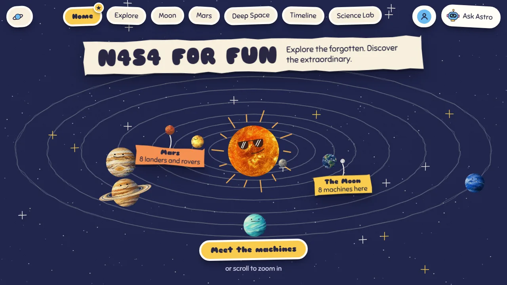
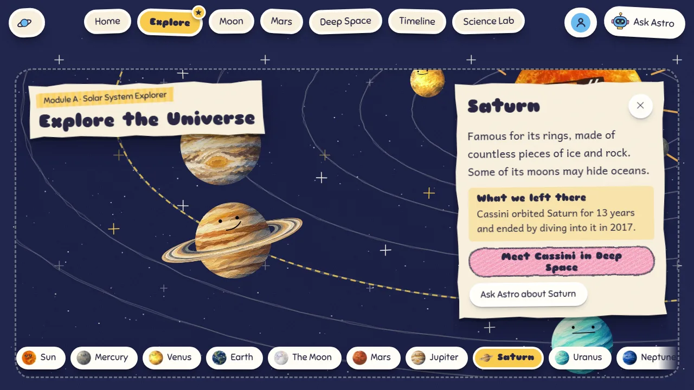
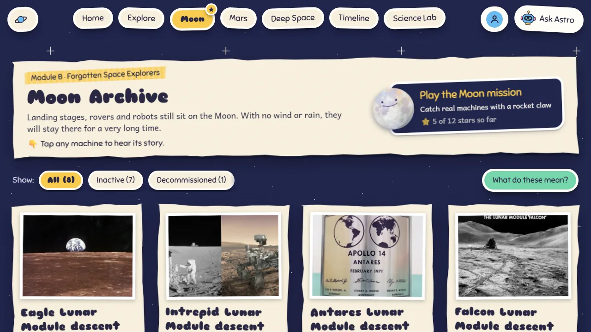
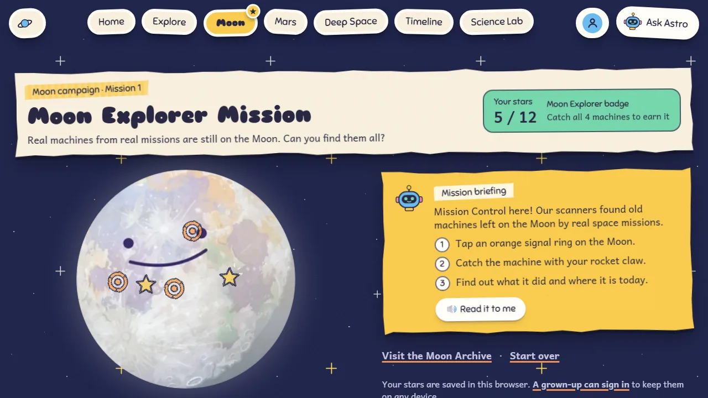
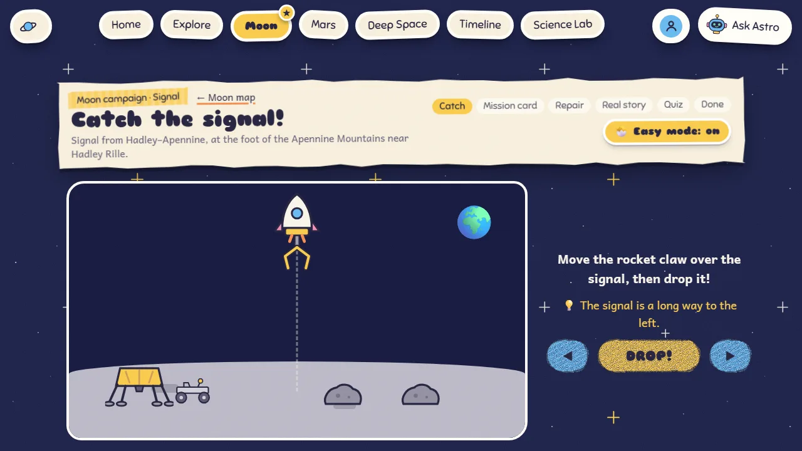
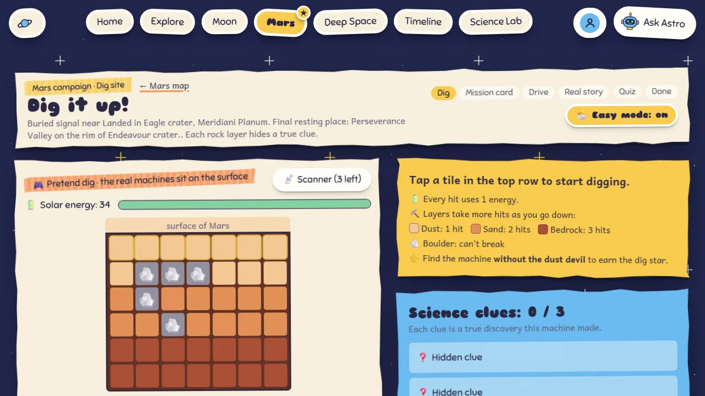
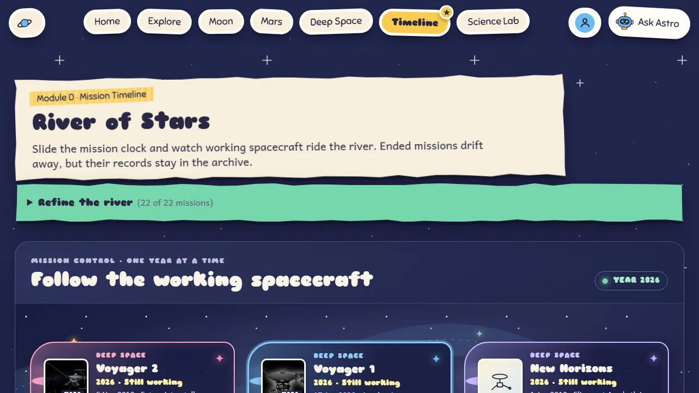
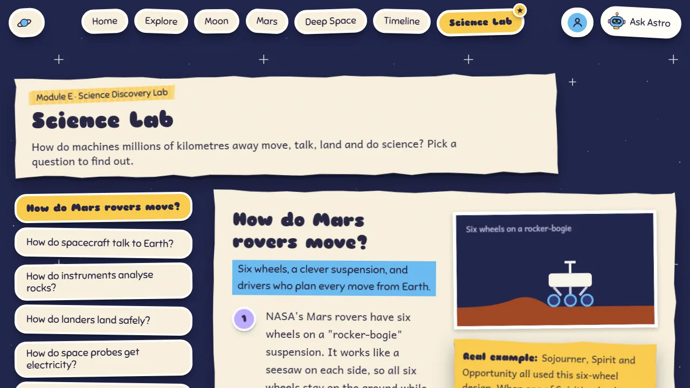
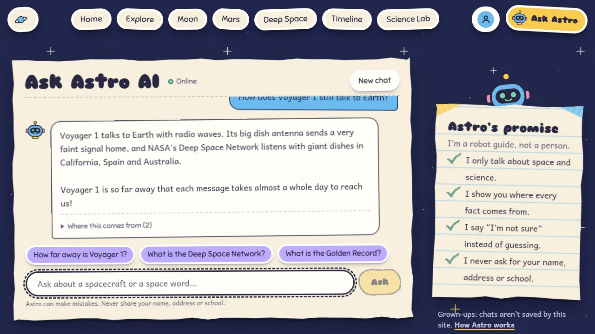
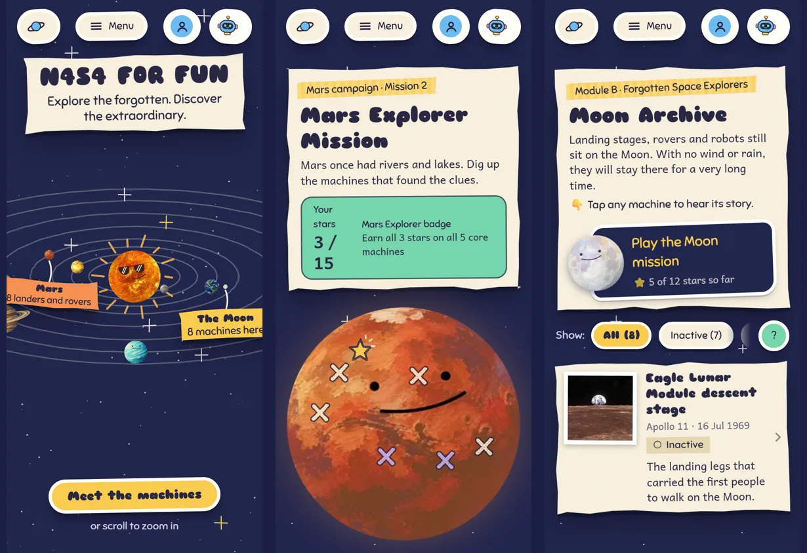

# N4S4 F0R FUN

**Explore the Forgotten. Discover the Extraordinary.**

An interactive, story-driven digital space museum for the **2026 NASA Space Apps Challenge**. It introduces school-age space fans (about 8–12) to the landers, rovers, descent stages and probes humanity has left on the Moon, on Mars and in deep space, and to the science they made possible.

> A student hackathon project. Not affiliated with or endorsed by NASA.



## Screenshots

| | |
|---|---|
|  **Explore the Universe:** spin the solar system and fly to a world |  **Moon Archive:** every machine left on the Moon, with its status |
|  **Moon Explorer Mission:** pick a signal on the painted Moon |  **Catch the signal:** steer the rocket claw and drop it |
|  **Mars dig:** dig through dust, sand and bedrock to find clues |  **River of Stars:** slide through the years of working spacecraft |
|  **Science Lab:** how machines far away move, talk and do science |  **Ask Astro AI:** a child-safe guide that shows where its facts come from |



<sub>The same site on a phone: home, the Mars mission map and the Moon Archive. Screenshots taken at 1280 × 720 and 390 × 844; the Astro answer was shown with a stand-in server, as in the browser tests.</sub>

## What's in version 0.1

| Module | Page | What it does |
|---|---|---|
| Home | `/` | A crayon solar system that fills the screen: scroll to zoom in, tap a planet (or the Moon and Mars name tags) to fly to it and read its card |
| A · Solar System Explorer | `/explore` | Spin the crayon solar system and tap a world to fly in close; facts and links to its archive |
| B · Forgotten Space Explorers | `/moon`, `/mars`, `/deep-space` | 18 verified artifact records with status filters and a slide-in information panel |
| C · Artifact Stories | `/artifact/:id` | Story, mission facts, objectives, instruments, discoveries, timeline, status, "words to know", sources |
| D · Mission Timeline | `/timeline` | Scrub a river of colored mission comets by year; ended missions drift out of focus while all 18 full equipment records remain in the archive |
| E · Science Lab | `/science-lab` | Six "how does it work?" explainers with animations, a signal-delay timer and a quiz |
| F · Astro AI | `/ask-astro` + floating button on every page | Child-safe AI guide, grounded in the museum's data, with a visible backend status badge |
| About | `/about` | Project, accuracy, child safety and privacy, tech stack |
| Account | `/account` + "Sign in" sticker in the header | Optional Google sign-in for grown-ups (Supabase Auth). Signed in, game stars are saved to the account and follow the explorer to any device |

Statuses are always shown with colour **and** an icon **and** a word: *Still working*, *Inactive*, *Decommissioned*, *Lost contact*, *Unknown*.

## Project structure

```
Nasa_Hackathon_N4S4_F0R_FUN/
├── frontend/                 React + TypeScript + Vite website
│   ├── src/
│   │   ├── components/       Navbar, Footer, Paper, ArtifactCard, ArtifactPanel,
│   │   │                     Timeline, ChatBot, AstroLauncher, ScienceVisual, …
│   │   ├── pages/            Home, UniverseExplorer, Moon/Mars/DeepSpaceArchive, ArtifactDetail,
│   │   │                     MissionTimeline, ScienceLab, AstroAI, About
│   │   ├── data/             artifacts.json, glossary.json (source of truth), planets.ts, science.ts
│   │   ├── types/            artifact.ts (TypeScript data model)
│   │   ├── context/          AstroProvider (chat state shared by every page)
│   │   ├── hooks/ services/  API client, NASA Image Library client, backend status
│   │   └── index.css         Design tokens and shared styles (Tailwind v4)
│   └── vercel.json           SPA routing + security headers for Vercel
├── backend/                  Python FastAPI server for Astro AI
│   ├── app/
│   │   ├── main.py           App, CORS, /api/health
│   │   ├── routes/           ai.py (chat, explain, suggested-questions), artifacts.py
│   │   ├── services/         ai_service.py, knowledge_service.py, safety.py
│   │   └── data/             Copy of frontend/src/data JSON (kept in sync, checked by tests)
│   ├── tests/                pytest suite
│   ├── pyproject.toml        ruff + pytest settings
│   └── .env.example
├── docs/                     architecture.md, data_sources.md
└── .github/                  CI workflow, Dependabot, PR and issue templates
```

## Run it locally

You need **Node.js 22** (see `.nvmrc`) and **Python 3.12** (see `.python-version`). Python 3.11+ also works.

### 1. Backend (Astro AI)

```bash
cd backend
python -m venv .venv
source .venv/bin/activate          # Windows: .venv\Scripts\activate
pip install -r requirements-dev.txt   # runtime + test/lint tools
cp .env.example .env               # optional: add ANTHROPIC_API_KEY or OPENROUTER_API_KEY
uvicorn app.main:app --reload --port 8000
```

API docs: http://localhost:8000/docs

**No API key?** Astro still works in **knowledge mode**: it answers from the museum's verified records and glossary, and says honestly when it doesn't know. Add `ANTHROPIC_API_KEY`, or `OPENROUTER_API_KEY` to use [OpenRouter](https://openrouter.ai) (choose the model with `OPENROUTER_MODEL`), to `backend/.env` to switch on **AI model mode**. The key stays on the server and is never sent to the browser.

### 2. Frontend

```bash
cd frontend
npm install
cp .env.example .env               # VITE_API_URL=http://localhost:8000
npm run dev
```

Open http://localhost:5173. The Astro panel shows whether the server is online and which mode it is in.

### 3. Google sign-in (optional)

Accounts are for grown-ups and are optional: with no Supabase settings, the site works and the "Sign in" sticker is hidden.

1. **Supabase:** create a project at [supabase.com](https://supabase.com). From **Project Settings → API**, copy the project URL and the **publishable** key (or legacy `anon` key) into `frontend/.env` as `VITE_SUPABASE_URL` and `VITE_SUPABASE_PUBLISHABLE_KEY`. Never use the secret / `service_role` key in the frontend.
2. **Google Cloud Console → APIs & Services:**
   - Set up the **OAuth consent screen** (app name, support email, scopes `email`, `profile`, `openid`).
   - Under **Credentials**, create an **OAuth client ID** of type *Web application*. Add `http://localhost:5173` and your Vercel URL under **Authorized JavaScript origins**, and `https://<project-ref>.supabase.co/auth/v1/callback` under **Authorized redirect URIs**.
3. **Supabase → Authentication → Sign In / Providers → Google:** switch it on and paste the Google client ID and secret.
4. **Supabase → Authentication → URL Configuration:** set **Site URL** to your Vercel URL, and add these **Redirect URLs**: `http://localhost:5173/account`, `https://<your-vercel-domain>/account`, and `https://*-<your-team>.vercel.app/account` for preview deploys.

5. **Supabase → SQL Editor:** paste and run [`supabase/migrations/20261115120000_game_progress.sql`](supabase/migrations/20261115120000_game_progress.sql). It creates the `game_progress` table (one row of game stars per account) with Row Level Security, so each account can only read and change its own row. Without it, sign-in still works and stars stay in the browser.

Google sends visitors back to `/account`, which finishes signing in.

When a grown-up signs in, the stars in that browser and in the account are merged (the best result for every machine), and later changes are saved to the account. Signing out clears the stars from that browser, so the next explorer on a shared computer starts fresh.

### Tests and checks

```bash
cd frontend && npm run check       # oxlint + Vitest + type-check + build
cd frontend && npm run test:e2e    # opens every page in Chrome, fails on any JS error
cd backend && pip install -r requirements-dev.txt
ruff check . && ruff format --check . && pytest
```

The same checks run automatically on every pull request (`.github/workflows/ci.yml`).

## Contributing

`main` is protected: changes go through a pull request, and CI must pass before merging. See [CONTRIBUTING.md](CONTRIBUTING.md) for the branch workflow.

## Editing the artifact data

1. Edit `frontend/src/data/artifacts.json` (the source of truth). Every record needs at least one `https://` source.
2. Copy it to the backend: `cd frontend && npm run sync-data`
3. Run `cd backend && pytest`. A test fails if the two copies differ.

Never add a fact you can't source. See `docs/data_sources.md`.

## Deploy

- **Frontend → Vercel:** import the repo, set **Root Directory** to `frontend`, add the env var `VITE_API_URL=https://<your-backend-url>` (plus `VITE_SUPABASE_URL` and `VITE_SUPABASE_PUBLISHABLE_KEY` for sign-in). `vercel.json` handles page routing.
- **Backend → any Python host** (for example Render or Railway): root `backend`, build `pip install -r requirements.txt`, start `uvicorn app.main:app --host 0.0.0.0 --port $PORT`. Set `ALLOWED_ORIGINS` to your Vercel URL and, optionally, `ANTHROPIC_API_KEY` or `OPENROUTER_API_KEY` (+ `OPENROUTER_MODEL`). Then set `VITE_API_URL` on Vercel to the backend URL and redeploy the frontend.

## Libraries and why they're here

| Library | Purpose |
|---|---|
| React, TypeScript, Vite | Component UI, type-checked data, fast dev server and build |
| react-router-dom | Page routes (`/moon`, `/artifact/:id`, …) |
| @supabase/supabase-js | Optional Google sign-in (Supabase Auth); loaded only when accounts are configured |
| Tailwind CSS v4 | Design tokens and utility styling |
| Framer Motion | Page, panel and timeline animations |
| FastAPI, Pydantic, Uvicorn | REST API with validated request/response models |
| httpx | Server-side calls to the AI model provider |
| python-dotenv | Loads `backend/.env` in development |

## Known limits and next steps

- The Sun, the Moon and the planets use painted art (short looping videos and stills in `frontend/public/planets/`, 4.8 MB in all). A world plays its video only while it is on screen and big enough to see, so the home page loads one video, not ten.
- Leaflet maps of landing sites are planned for the Moon and Mars archives (coordinates are already in the data).
- Artifact photos load live from the NASA Image and Video Library; if none is found, an illustration is shown.
- The rate limiter is in-memory (fine for one server; use Redis if you scale out).
- Facts were written from NASA NSSDCA records and NASA Science pages. Re-check dates and statuses before the final submission, especially for spacecraft that are still working.

## Thank you

Thank you to **Yvonne Lee Yee Mun** for the painted art of the Sun, the Moon and all eight planets. Her art is what you see in the solar system on the home page, in Explore, and on the Moon and Mars mission maps.

## Licence

MIT. See `LICENSE`. NASA images are used under NASA's media usage guidelines.
