# Forgotten space explorers: equipment files

21 pieces of hardware left on the Moon, on Mars and in deep space. Text comes from the museum's verified data (`frontend/src/data/artifacts.json`); photos come from the NASA Image and Video Library.

## The Moon

| Photo | Equipment | Mission | Status |
|---|---|---|---|
|  | [Eagle Lunar Module descent stage](moon/apollo-11-eagle/README.md) | Apollo 11 | Inactive |
| 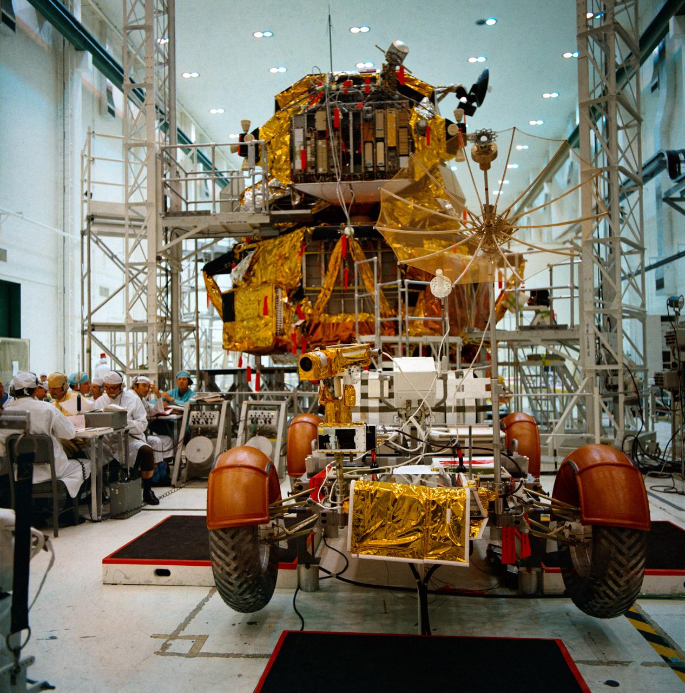 | [Lunar Roving Vehicle 1](moon/apollo-15-lrv/README.md) | Apollo 15 | Inactive |
| 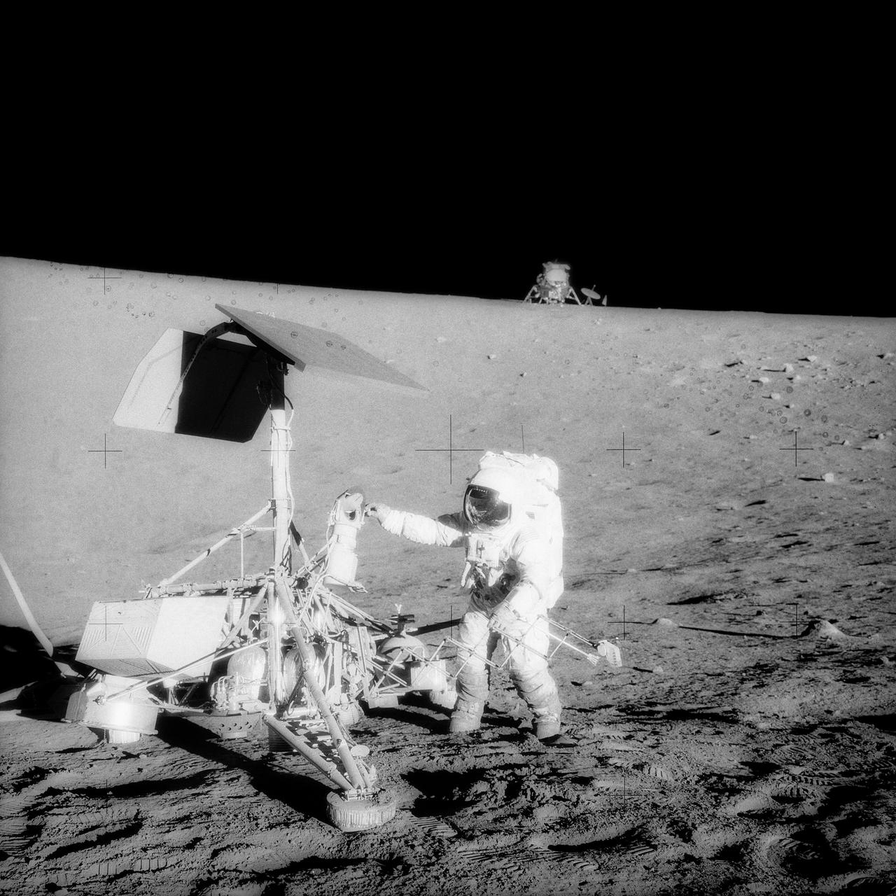 | [Surveyor 3](moon/surveyor-3/README.md) | Surveyor 3 | Inactive |
| 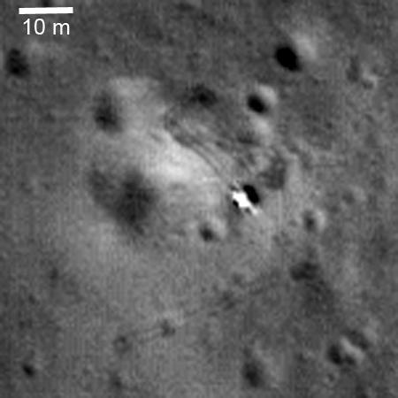 | [Lunokhod 1](moon/lunokhod-1/README.md) | Luna 17 | Inactive |
| 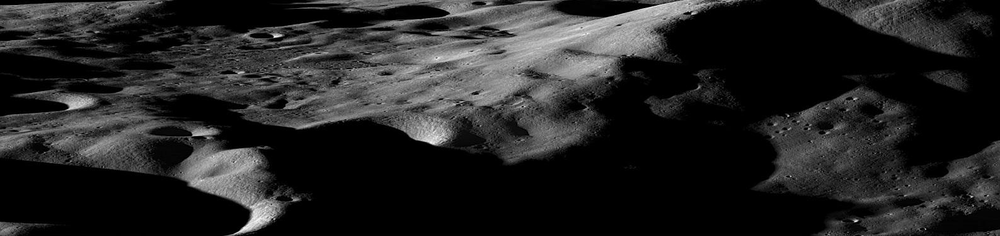 | [LCROSS](moon/lcross/README.md) | Lunar Crater Observation and Sensing Satellite | Decommissioned |

## Mars

| Photo | Equipment | Mission | Status |
|---|---|---|---|
| 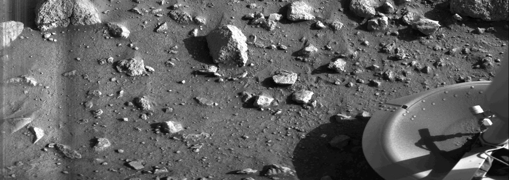 | [Viking 1 lander](mars/viking-1-lander/README.md) | Viking 1 | Lost contact |
| 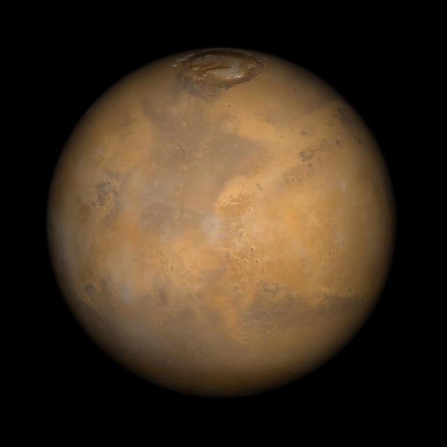 | [Mars Pathfinder lander](mars/mars-pathfinder/README.md) | Mars Pathfinder | Lost contact |
| 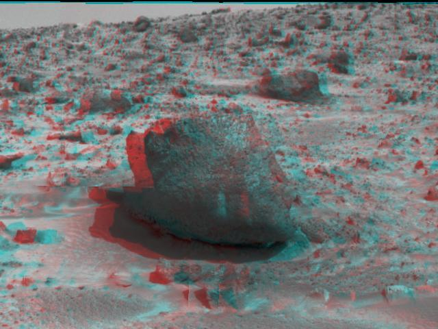 | [Sojourner rover](mars/sojourner/README.md) | Mars Pathfinder | Lost contact |
| 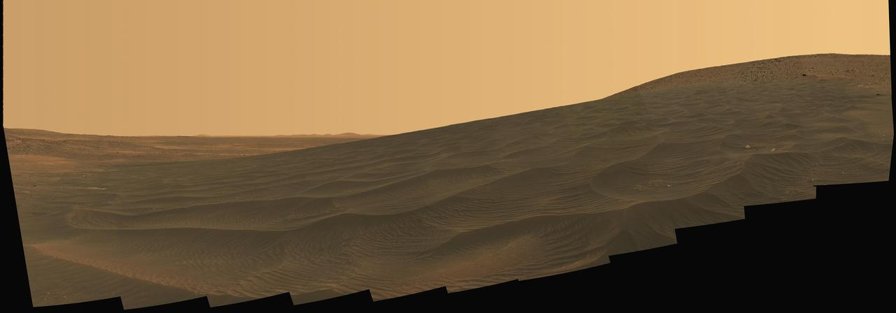 | [Spirit rover](mars/spirit/README.md) | Mars Exploration Rover A | Lost contact |
| 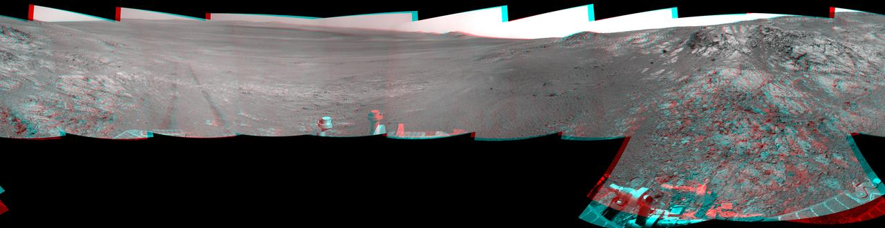 | [Opportunity rover](mars/opportunity/README.md) | Mars Exploration Rover B | Lost contact |
| 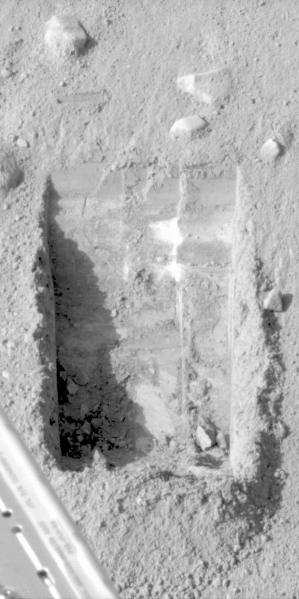 | [Phoenix lander](mars/phoenix/README.md) | Phoenix Mars Mission | Lost contact |
| 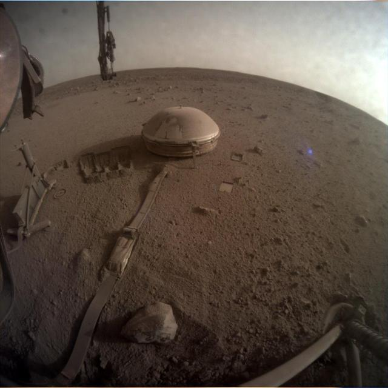 | [InSight lander](mars/insight/README.md) | Interior Exploration using Seismic Investigations, Geodesy and Heat Transport | Lost contact |
| 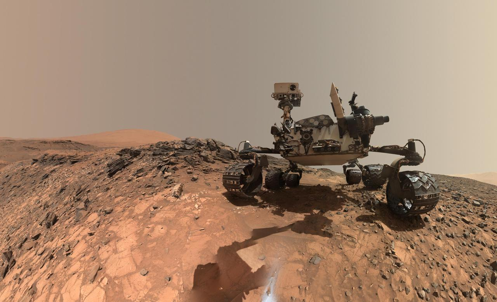 | [Curiosity rover](mars/curiosity/README.md) | Mars Science Laboratory | Still working |
| 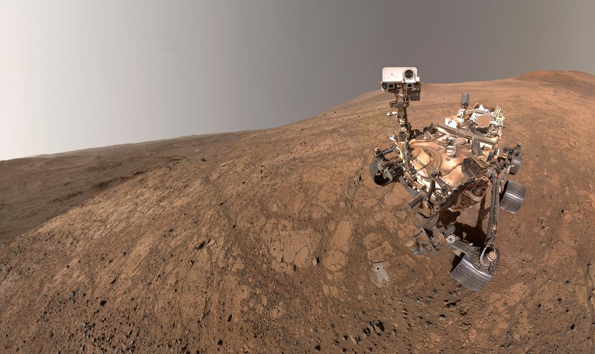 | [Perseverance rover](mars/perseverance/README.md) | Mars 2020 | Still working |
| 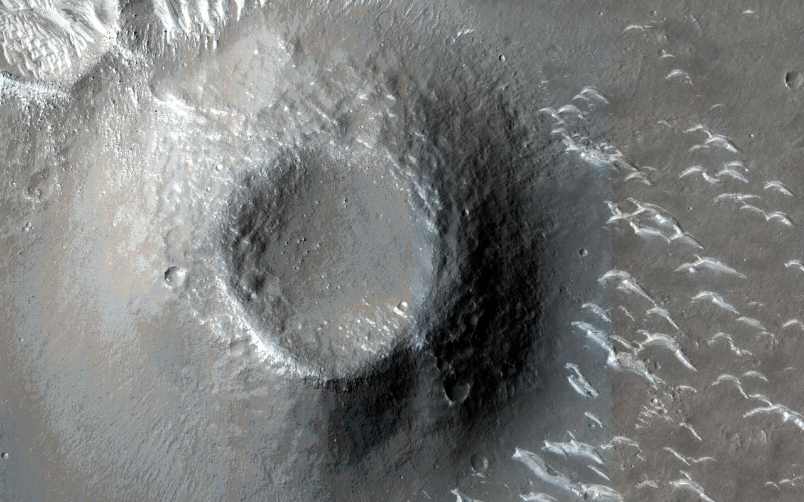 | [Zhurong rover](mars/zhurong/README.md) | Tianwen-1 | Inactive |

## Deep space

| Photo | Equipment | Mission | Status |
|---|---|---|---|
| 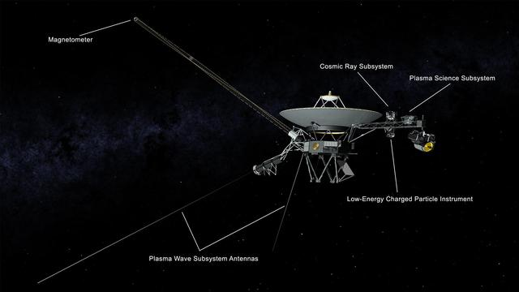 | [Voyager 1](deep-space/voyager-1/README.md) | Voyager | Still working |
| 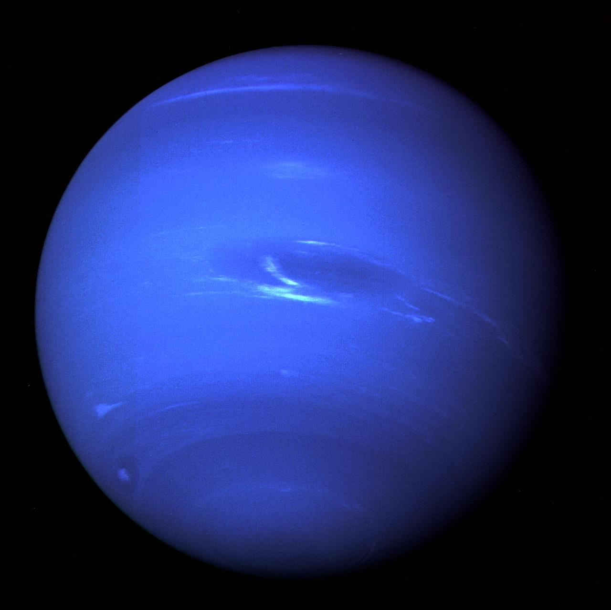 | [Voyager 2](deep-space/voyager-2/README.md) | Voyager | Still working |
| 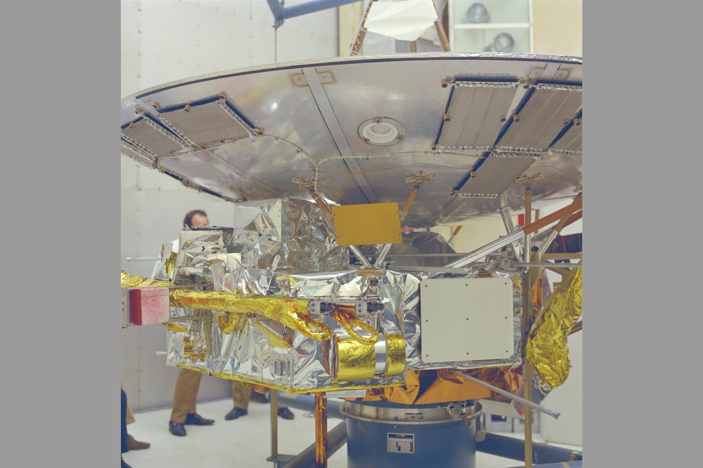 | [Pioneer 10](deep-space/pioneer-10/README.md) | Pioneer 10 | Lost contact |
| 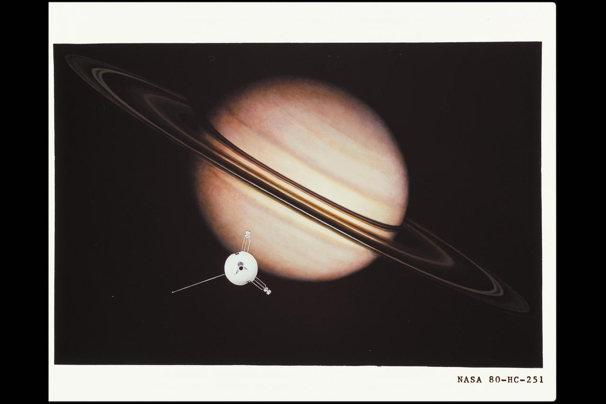 | [Pioneer 11](deep-space/pioneer-11/README.md) | Pioneer 11 | Lost contact |
| 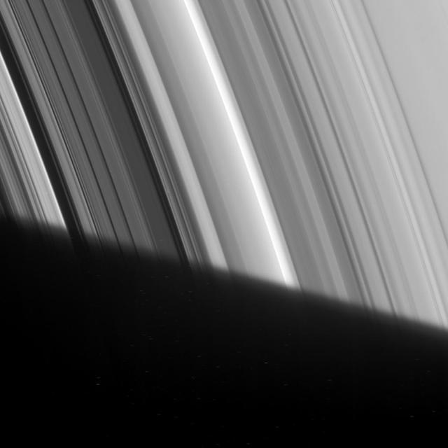 | [Cassini](deep-space/cassini/README.md) | Cassini–Huygens | Decommissioned |
| 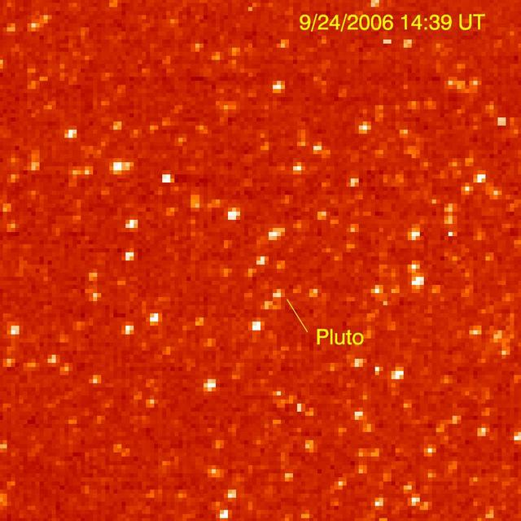 | [New Horizons](deep-space/new-horizons/README.md) | New Horizons | Still working |
