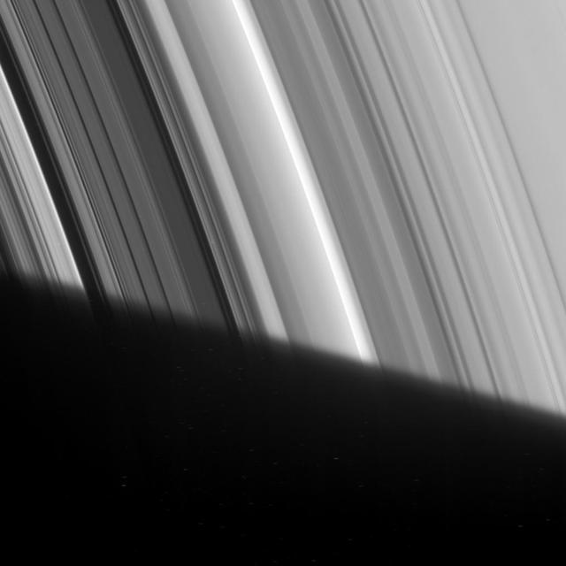
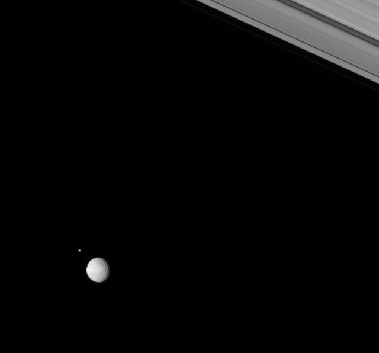

# Cassini

*The orbiter that found an ocean hiding inside a moon.*

| | |
|---|---|
| Mission | Cassini–Huygens |
| Agency | NASA, ESA and the Italian Space Agency |
| Where | Deep space: Burned up in Saturn's atmosphere |
| Hardware type | orbiter |
| Status | **Decommissioned**: Ended on purpose on 15 September 2017 by diving into Saturn, so it could never crash into and contaminate moons that might be habitable. |
| Launched | 1997-10-15 |
| Arrived | 2004-07-01 |
| Mission ended | 2017-09-15 |

## The story

Cassini travelled almost seven years to reach Saturn. It carried a passenger: the European Huygens probe, which parachuted down onto Saturn's giant moon Titan.
For 13 years Cassini looped around Saturn. It flew through jets of icy spray shooting out of a small moon called Enceladus, and found they come from a salty ocean beneath the ice.
When its fuel was nearly gone, the team steered Cassini into Saturn on purpose. That way it could never crash into Enceladus or Titan, places that might be able to support life.

## What it was sent to do

- Study Saturn, its rings and its moons up close
- Deliver the Huygens probe to Titan
- Investigate whether Saturn's moons could support life

## Instruments

- **Imaging cameras**: Took hundreds of thousands of pictures of Saturn, its rings and moons.
- **Radar**: Saw through Titan's thick haze to map its surface.
- **Ion and Neutral Mass Spectrometer**: Tasted gases in Enceladus's icy jets.
- **Cosmic Dust Analyzer**: Studied tiny grains in the rings and in the jets.

## What we learned

- Found jets of water spraying from Enceladus, fed by an ocean under its ice.
- Found seas and lakes of liquid methane and ethane on Titan.
- Discovered new moons and learned how Saturn's rings change.

## Timeline

- 1997-10-15: Cassini launches with the Huygens probe
- 2004-07-01: Enters orbit around Saturn
- 2005-01-14: Huygens lands on Titan
- 2005: Icy jets discovered at Enceladus
- 2017-04: Begins its 'Grand Finale' dives between Saturn and its rings
- 2017-09-15: Dives into Saturn and ends its mission

## Fun fact

Cassini kept sending science data until the very last moment of its plunge into Saturn.

## Sources

- [NASA NSSDCA: Cassini](https://nssdc.gsfc.nasa.gov/nmc/spacecraft/display.action?id=1997-061A)
- [NASA Science: Cassini mission](https://science.nasa.gov/mission/cassini/)

## Image credits

- `image-1.jpg`: **The Familiar Division**. NASA ID `PIA08901`, JPL, 2007-03-21. <https://images.nasa.gov/details/PIA08901>
- `image-2.jpg`: **Helene and Mimas**. NASA ID `PIA08897`, JPL, 2007-03-15. <https://images.nasa.gov/details/PIA08897>

Images from the NASA Image and Video Library. NASA material is generally not copyrighted, but check each image's page for any third-party rights before publishing.
