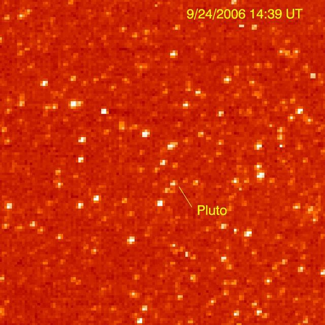
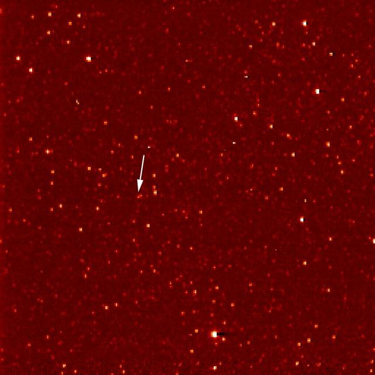

# New Horizons

*The first spacecraft to visit Pluto.*

| | |
|---|---|
| Mission | New Horizons |
| Agency | NASA |
| Where | Deep space: The Kuiper Belt, beyond Neptune |
| Hardware type | probe |
| Status | **Still working**: Still working and exploring the Kuiper Belt, the icy region beyond Neptune. |
| Launched | 2006-01-19 |
| Arrived | 2015-07-14 |
| Mission ended | still going |

## The story

When New Horizons launched in 2006, Pluto was just a blurry dot in even the best telescopes. Nobody knew what it really looked like.
After a journey of nine and a half years, New Horizons zoomed past Pluto in July 2015. Pluto had a giant heart-shaped plain of frozen nitrogen and mountains made of water ice!
Then it kept going, and in 2019 it flew past Arrokoth, the most distant object any spacecraft has ever visited up close.

## What it was sent to do

- Make the first close-up study of Pluto and its moons
- Explore objects in the Kuiper Belt

## Instruments

- **LORRI telescope camera**: Took detailed black-and-white pictures from far away.
- **Ralph**: Took colour pictures and mapped what surfaces are made of.
- **Alice**: Studied the thin air around Pluto using ultraviolet light.
- **Venetia Burney Student Dust Counter**: Counts dust grains in space. It was built by university students.

## What we learned

- Revealed Pluto's heart-shaped plain of nitrogen ice, Sputnik Planitia.
- Found mountains of water ice and a hazy blue sky on Pluto.
- Visited Arrokoth, a 'snowman-shaped' object left over from when the planets formed.

## Timeline

- 2006-01-19: New Horizons launches
- 2007-02-28: Gets a speed boost from Jupiter's gravity
- 2015-07-14: First-ever flyby of Pluto
- 2019-01-01: Flies past Arrokoth in the Kuiper Belt

## Fun fact

New Horizons carries some of the ashes of Clyde Tombaugh, the astronomer who discovered Pluto in 1930.

## Sources

- [NASA NSSDCA: New Horizons](https://nssdc.gsfc.nasa.gov/nmc/spacecraft/display.action?id=2006-001A)
- [NASA Science: New Horizons mission](https://science.nasa.gov/mission/new-horizons/)

## Image credits

- `image-1.jpg`: **New Horizons Sees Pluto**. NASA ID `PIA09234`, JPL, 2007-04-02. <https://images.nasa.gov/details/PIA09234>
- `image-2.jpg`: **New Horizons Sees Pluto Sept. 21**. NASA ID `PIA09232`, JPL, 2007-04-02. <https://images.nasa.gov/details/PIA09232>

Images from the NASA Image and Video Library. NASA material is generally not copyrighted, but check each image's page for any third-party rights before publishing.
