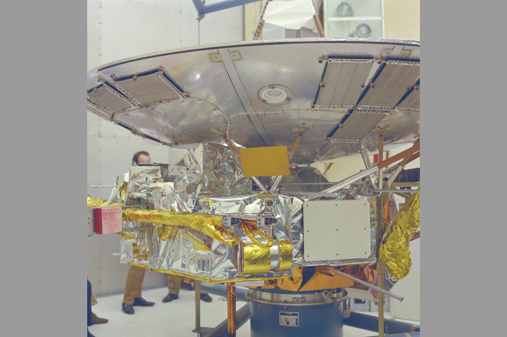
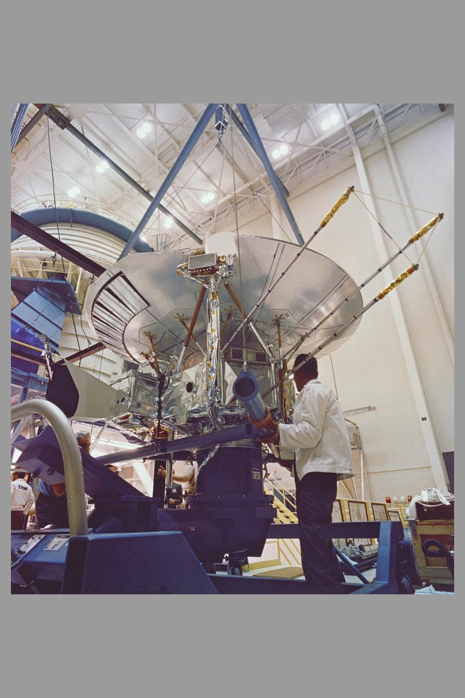

# Pioneer 10

*The first spacecraft to cross the asteroid belt and visit Jupiter.*

| | |
|---|---|
| Mission | Pioneer 10 |
| Agency | NASA |
| Where | Deep space: Far beyond the planets, heading out of the solar system |
| Hardware type | probe |
| Status | **Lost contact**: Its last, very weak signal was received on 23 January 2003. Its power source had grown too weak to answer again. |
| Launched | 1972-03-03 |
| Arrived | 1973-12-03 |
| Mission ended | 2003-01-23 |

## The story

In 1972, nobody knew if a spacecraft could survive a trip through the asteroid belt. Pioneer 10 went first, and made it through safely.
In 1973 it became the first spacecraft to fly past Jupiter, taking close-up pictures and measuring the planet's powerful radiation.
Pioneer 10 carries a metal plaque with a drawing of a man and a woman and a map showing where Earth is, like a message in a bottle.

## What it was sent to do

- Find out if spacecraft could safely cross the asteroid belt
- Make the first close-up study of Jupiter
- Study the solar wind far from the Sun

## Instruments

- **Imaging photopolarimeter**: Built up pictures of Jupiter one strip at a time as the spacecraft spun.
- **Magnetometer**: Measured Jupiter's huge magnetic field.
- **Charged particle detectors**: Measured the dangerous radiation around Jupiter.

## What we learned

- Showed that spacecraft could cross the asteroid belt safely.
- Took the first close-up images of Jupiter.
- Measured Jupiter's intense radiation belts, which helped engineers design later missions.

## Timeline

- 1972-03-03: Pioneer 10 launches
- 1972-07: Enters the asteroid belt
- 1973-12-03: First spacecraft to fly past Jupiter
- 1983-06-13: Passes the orbit of Neptune
- 2003-01-23: Last signal received

## Fun fact

Pioneer 10's plaque shows our solar system's planets, with an arrow pointing out the third one: Earth.

## Sources

- [NASA NSSDCA: Pioneer 10](https://nssdc.gsfc.nasa.gov/nmc/spacecraft/display.action?id=1972-012A)

## Image credits

- `image-1.jpg`: **ARC-1972-AC72-2135**. NASA ID `ARC-1972-AC72-2135`, ARC, 1972-02-26. <https://images.nasa.gov/details/ARC-1972-AC72-2135>
- `image-2.jpg`: **ARC-1973-AC73-9019**. NASA ID `ARC-1973-AC73-9019`, ARC, 1973-10-19. <https://images.nasa.gov/details/ARC-1973-AC73-9019>

Images from the NASA Image and Video Library. NASA material is generally not copyrighted, but check each image's page for any third-party rights before publishing.
