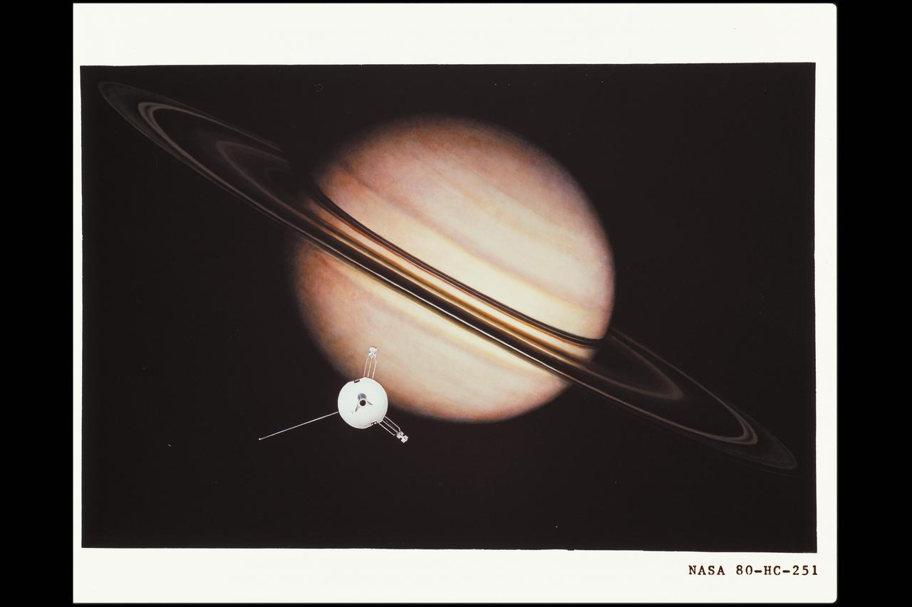
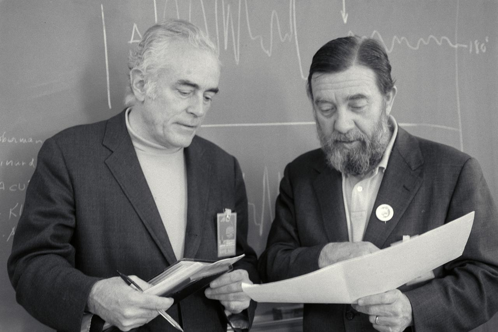

# Pioneer 11

*The first spacecraft to visit Saturn.*

| | |
|---|---|
| Mission | Pioneer 11 |
| Agency | NASA |
| Where | Deep space: Far beyond the planets, heading out of the solar system |
| Hardware type | probe |
| Status | **Lost contact**: Contact ended on 30 September 1995, when its power was too low to keep working. |
| Launched | 1973-04-06 |
| Arrived | 1979-09-01 |
| Mission ended | 1995-09-30 |

## The story

Pioneer 11 followed its twin, Pioneer 10, past Jupiter. It flew even closer, then used Jupiter's gravity to swing all the way across the solar system to Saturn.
In 1979 it became the first spacecraft to visit Saturn. It discovered a new ring and showed the way for the Voyager probes coming after it.
Like Pioneer 10, it carries a plaque with a message from Earth.

## What it was sent to do

- Study Jupiter up close
- Become the first spacecraft to visit Saturn
- Scout a safe route for the Voyager spacecraft

## Instruments

- **Imaging photopolarimeter**: Built up pictures of Jupiter and Saturn as the spacecraft spun.
- **Magnetometer**: Measured the magnetic fields of Jupiter and Saturn.
- **Charged particle detectors**: Measured radiation around the giant planets.

## What we learned

- First spacecraft to fly past Saturn.
- Discovered Saturn's thin F ring.
- Measured Saturn's magnetic field for the first time.

## Timeline

- 1973-04-06: Pioneer 11 launches
- 1974-12: Flies close past Jupiter
- 1979-09-01: First spacecraft to visit Saturn
- 1995-09-30: Last contact with Earth

## Fun fact

At Saturn, Pioneer 11 passed only about 21,000 km above the planet's cloud tops.

## Sources

- [NASA NSSDCA: Pioneer 11](https://nssdc.gsfc.nasa.gov/nmc/spacecraft/display.action?id=1973-019A)

## Image credits

- `image-1.jpg`: **ARC-2000-80-HC-251**. NASA ID `ARC-2000-80-HC-251`, ARC, 2000-04-26. <https://images.nasa.gov/details/ARC-2000-80-HC-251>
- `image-2.jpg`: **ARC-1974-A74-9030-1**. NASA ID `ARC-1974-A74-9030-1`, ARC, 1974-12-05. <https://images.nasa.gov/details/ARC-1974-A74-9030-1>

Images from the NASA Image and Video Library. NASA material is generally not copyrighted, but check each image's page for any third-party rights before publishing.
