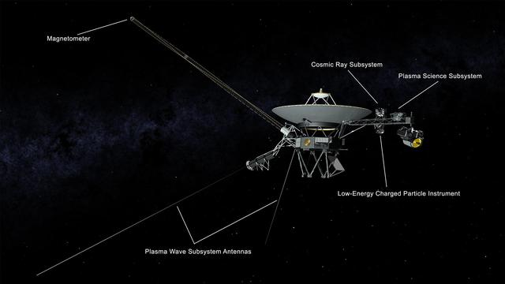
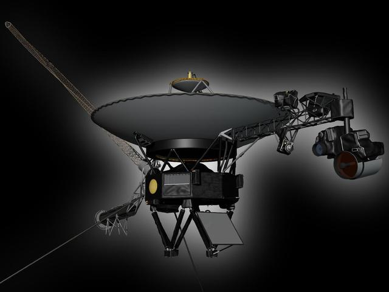

# Voyager 1

*The farthest human-made object, still talking to Earth.*

| | |
|---|---|
| Mission | Voyager |
| Agency | NASA |
| Where | Deep space: Interstellar space, beyond the heliopause |
| Hardware type | probe |
| Status | **Still working**: Still sending data from interstellar space. To save power, engineers have switched off most instruments; in April 2026 they turned off another, leaving two science instruments running. |
| Launched | 1977-09-05 |
| Arrived | 2012-08-25 |
| Mission ended | still going |

## The story

Voyager 1 launched in 1977, before most of your parents were born! It flew past Jupiter and Saturn and sent home amazing close-up pictures.
Then it kept going. In 2012 it became the first spacecraft to reach interstellar space, the region between the stars, beyond the bubble the Sun blows around our solar system.
Voyager 1 carries a golden record with sounds and pictures of Earth, in case anyone ever finds it. Its power drops a little every year, so engineers switch off instruments one by one to keep it talking as long as possible.

## What it was sent to do

- Fly past and study Jupiter and Saturn and their moons
- Study the outer edge of the Sun's influence
- Explore interstellar space

## Instruments

- **Imaging cameras**: Photographed Jupiter, Saturn and their moons. Switched off in 1990 after taking the 'Pale Blue Dot' picture.
- **Magnetometer**: Measures magnetic fields. Still working.
- **Plasma wave subsystem**: Listens to waves in the thin gas between the stars. Still working.
- **Radioisotope power generators**: Turn heat from radioactive material into electricity, because sunlight is far too weak out there.

## What we learned

- Found active volcanoes on Jupiter's moon Io, the first seen anywhere beyond Earth.
- Took the 'Pale Blue Dot' picture showing Earth as a tiny speck, in 1990.
- Became the first spacecraft to enter interstellar space, in 2012.

## Timeline

- 1977-09-05: Voyager 1 launches
- 1979-03-05: Closest approach to Jupiter; volcanoes found on Io
- 1980-11-12: Flies past Saturn and its moon Titan
- 1990-02-14: Takes the 'Pale Blue Dot' picture of Earth
- 2012-08-25: Enters interstellar space
- 2026-04-17: Another instrument switched off to save power

## Fun fact

Voyager 1's computers have far less memory than a modern phone, yet engineers still send it software updates.

## Sources

- [NASA NSSDCA: Voyager 1](https://nssdc.gsfc.nasa.gov/nmc/spacecraft/display.action?id=1977-084A)
- [NASA Science: Voyager mission](https://science.nasa.gov/mission/voyager/)
- [NASA: Instrument shut off on Voyager 1 (April 2026)](https://science.nasa.gov/blogs/voyager/2026/04/17/nasa-shuts-off-instrument-on-voyager-1-to-keep-spacecraft-operating/)

## Image credits

- `image-1.jpg`: **Voyager 2 Spacecraft Instruments**. NASA ID `PIA22915`, JPL, 2018-12-10. <https://images.nasa.gov/details/PIA22915>
- `image-2.jpg`: **Model of Voyager Artist Concept**. NASA ID `PIA14111`, JPL, 2011-04-29. <https://images.nasa.gov/details/PIA14111>

Images from the NASA Image and Video Library. NASA material is generally not copyrighted, but check each image's page for any third-party rights before publishing.
