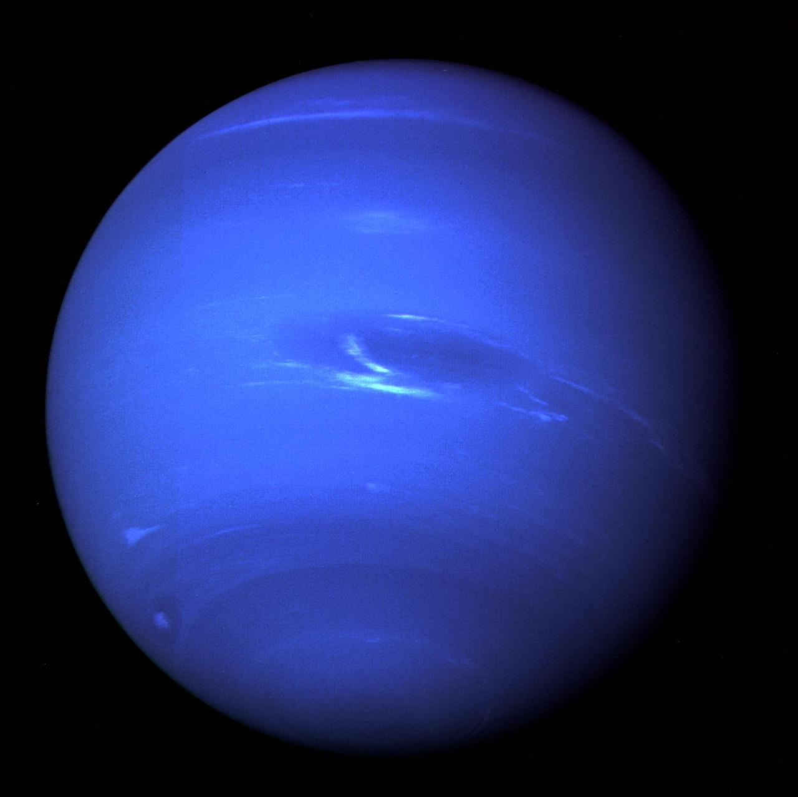
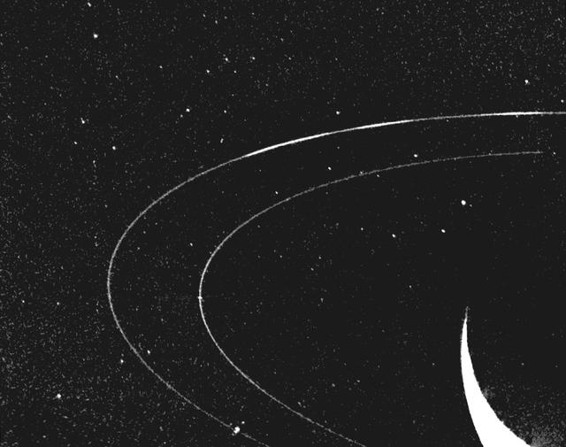

# Voyager 2

*The only spacecraft ever to visit Uranus and Neptune.*

| | |
|---|---|
| Mission | Voyager |
| Agency | NASA |
| Where | Deep space: Interstellar space, beyond the heliopause |
| Hardware type | probe |
| Status | **Still working**: Still sending data from interstellar space. Several instruments have been switched off to save power. |
| Launched | 1977-08-20 |
| Arrived | 2018-11-05 |
| Mission ended | still going |

## The story

Voyager 2 actually launched 16 days before its twin, Voyager 1. It took a longer path that let it visit all four giant planets.
Using the gravity of each planet like a slingshot, it flew past Jupiter, Saturn, Uranus and Neptune. No other spacecraft has ever been to Uranus or Neptune.
In 2018 it followed Voyager 1 into interstellar space. It also carries a golden record full of greetings, music and sounds from Earth.

## What it was sent to do

- Visit Jupiter and Saturn, then Uranus and Neptune
- Study the giant planets' moons, rings and magnetic fields
- Explore the edge of the Sun's influence and beyond

## Instruments

- **Imaging cameras**: Took the only close-up pictures we have of Uranus and Neptune.
- **Magnetometer**: Measures magnetic fields in space.
- **Plasma wave subsystem**: Listens to waves in the charged gas of space.
- **Radioisotope power generators**: Make electricity from the heat of radioactive material.

## What we learned

- Discovered new moons and rings around Uranus and Neptune.
- Saw Neptune's 'Great Dark Spot', a giant storm.
- Found geysers on Neptune's moon Triton.

## Timeline

- 1977-08-20: Voyager 2 launches
- 1979-07-09: Closest approach to Jupiter
- 1981-08-25: Flies past Saturn
- 1986-01-24: First and only visit to Uranus
- 1989-08-25: First and only visit to Neptune
- 2018-11-05: Enters interstellar space

## Fun fact

Voyager 2 used each giant planet's gravity as a slingshot. That lucky line-up of planets happens only about once every 175 years.

## Sources

- [NASA NSSDCA: Voyager 2](https://nssdc.gsfc.nasa.gov/nmc/spacecraft/display.action?id=1977-076A)
- [NASA Science: Voyager mission](https://science.nasa.gov/mission/voyager/)

## Image credits

- `image-1.jpg`: **PIA01492**. NASA ID `PIA01492`, JPL, 1998-10-30. <https://images.nasa.gov/details/PIA01492>
- `image-2.jpg`: **Neptune Rings**. NASA ID `PIA01493`, JPL, 1998-10-30. <https://images.nasa.gov/details/PIA01493>

Images from the NASA Image and Video Library. NASA material is generally not copyrighted, but check each image's page for any third-party rights before publishing.
