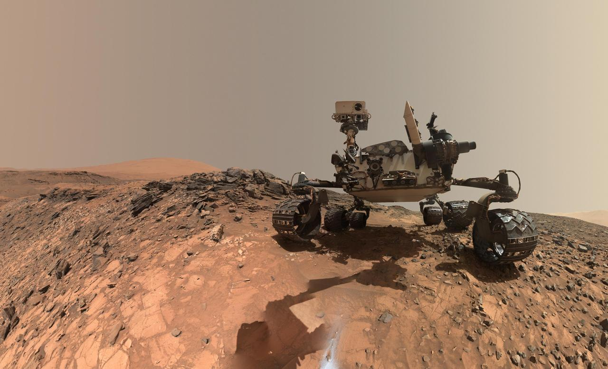
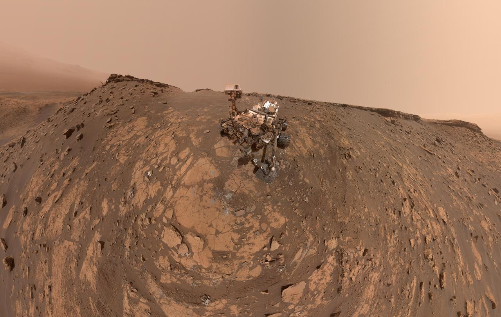

# Curiosity rover

*A car-sized science lab that has been climbing a Martian mountain since 2012.*

| | |
|---|---|
| Mission | Mars Science Laboratory |
| Agency | NASA |
| Where | Mars: Landed in Gale crater; now climbing Mount Sharp (Aeolis Mons) (lat -4.59, lon 137.44) |
| Hardware type | rover |
| Status | **Still working**: Still exploring. NASA lists it as an active mission; in August 2026 it had climbed 1 kilometre up Mount Sharp since landing. |
| Launched | 2011-11-26 |
| Arrived | 2012-08-06 |
| Mission ended | still going |

## The story

Curiosity is about the size of a small car and weighs 899 kg on Earth. It was lowered onto Mars on cables by a rocket-powered 'sky crane' on 6 August 2012.
It doesn't use solar panels. A nuclear power source keeps it warm and running through dusty seasons and cold nights.
Its job is to read the rock layers of Mount Sharp like the pages of a history book, to find out whether Mars ever had places where tiny life could have lived.

## What it was sent to do

- Find out whether Gale crater ever had conditions that could support microbial life
- Study the rocks and soil layer by layer while climbing Mount Sharp
- Measure Mars's weather and the radiation at the surface, to help plan future human missions

## Instruments

- **ChemCam**: Zaps rocks with a laser from several metres away and reads the flash of light to find out what they are made of.
- **SAM (Sample Analysis at Mars)**: A mini chemistry lab that bakes powdered rock and sniffs the gases, looking for carbon-based (organic) molecules.
- **CheMin**: Uses X-rays to identify the minerals in drilled rock powder.
- **Mastcam and MAHLI**: Colour cameras on the mast and the arm, including the close-up camera used for Curiosity's famous selfies.
- **RAD**: Measures the radiation at the surface of Mars.

## What we learned

- Early in the mission it found chemical and mineral evidence that Gale crater once had environments that could have supported life.
- It found decane, undecane and dodecane in a rock called 'Cumberland': the largest organic molecules found on Mars so far.
- In 2026 it passed 1 kilometre of climbing up Mount Sharp.

## Timeline

- 2011-11-26: Launches from Cape Canaveral
- 2012-08-06: Sky crane lowers Curiosity into Gale crater
- 2026-08-26: Reaches 1 km of elevation gained on Mount Sharp

## Fun fact

On Mars, Curiosity's 899 kg 'feels' like only 337 kg, because Mars's gravity is about a third of Earth's.

## Sources

- [NASA Science: Mars Science Laboratory / Curiosity](https://science.nasa.gov/mission/msl-curiosity/)

## Image credits

- `image-1.jpg`: **Looking Up at Mars Rover Curiosity in Buckskin Selfie**. NASA ID `PIA19808`, JPL, 2015-08-19. <https://images.nasa.gov/details/PIA19808>
- `image-2.jpg`: **Curiosity at the Hutton Drill Site**. NASA ID `PIA23624`, JPL, 2020-03-20. <https://images.nasa.gov/details/PIA23624>

Images from the NASA Image and Video Library. NASA material is generally not copyrighted, but check each image's page for any third-party rights before publishing.
