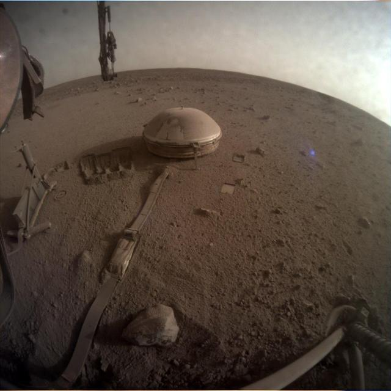
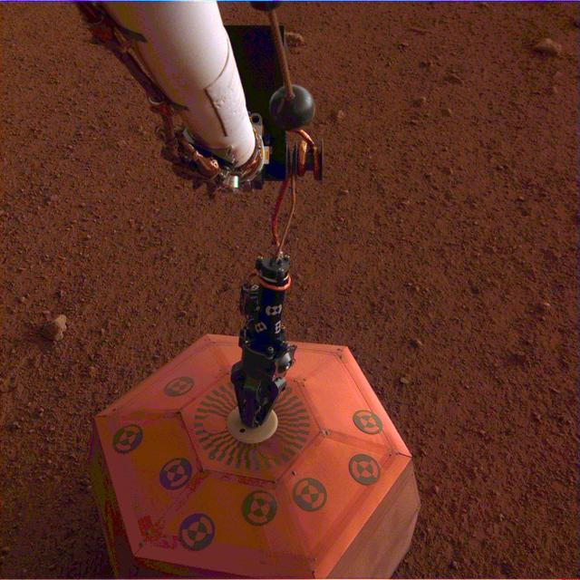

# InSight lander

*The lander that listened to marsquakes.*

| | |
|---|---|
| Mission | Interior Exploration using Seismic Investigations, Geodesy and Heat Transport |
| Agency | NASA |
| Where | Mars: Elysium Planitia (lat 4.5, lon 135.62) |
| Hardware type | lander |
| Status | **Lost contact**: Dust slowly covered its solar panels. After it missed two contact attempts, NASA ended the mission on 21 December 2022. |
| Launched | 2018-05-05 |
| Arrived | 2018-11-26 |
| Mission ended | 2022-12-15 |

## The story

Every other Mars mission looked at the surface. InSight wanted to know what Mars is like deep inside.
It placed a super-sensitive seismometer on the ground and covered it with a dome to block the wind. Then it listened. When Mars shook, waves travelled through the planet, and their echoes revealed what lies underneath.
InSight heard more than 1,300 marsquakes. Using them, scientists measured the size of Mars's core for the first time.

## What it was sent to do

- Study the deep interior of Mars: crust, mantle and core
- Measure marsquakes and meteorite impacts
- Measure how heat flows out of the planet

## Instruments

- **SEIS seismometer**: Listened for marsquakes and impacts. It was sensitive enough to feel vibrations smaller than an atom.
- **HP3 heat probe ('the mole')**: Tried to hammer itself deep underground to measure heat. The soil turned out to be too clumpy for it to dig deep.
- **RISE radio experiment**: Tracked tiny wobbles in Mars's spin to learn about its core.
- **Weather sensors**: Measured wind, temperature and air pressure.

## What we learned

- Detected more than 1,300 marsquakes.
- Found that Mars has a liquid metal core and measured how big it is.
- Mapped the layers of Mars's crust.

## Timeline

- 2018-05-05: InSight launches
- 2018-11-26: Lands in Elysium Planitia
- 2019-04-06: Records its first likely marsquake
- 2022-05-04: Records the largest marsquake ever detected
- 2022-12-15: Last contact with Earth
- 2022-12-21: NASA ends the mission

## Fun fact

InSight's seismometer was so sensitive that it could also feel the wind and passing dust devils.

## Sources

- [NASA NSSDCA: InSight](https://nssdc.gsfc.nasa.gov/nmc/spacecraft/display.action?id=2018-042A)

## Image credits

- `image-1.jpg`: **One of InSight's Last Images**. NASA ID `PIA25680`, JPL, 2022-06-21. <https://images.nasa.gov/details/PIA25680>
- `image-2.jpg`: **SEIS Deployed on Mars**. NASA ID `PIA22956`, JPL, 2018-12-19. <https://images.nasa.gov/details/PIA22956>

Images from the NASA Image and Video Library. NASA material is generally not copyrighted, but check each image's page for any third-party rights before publishing.
