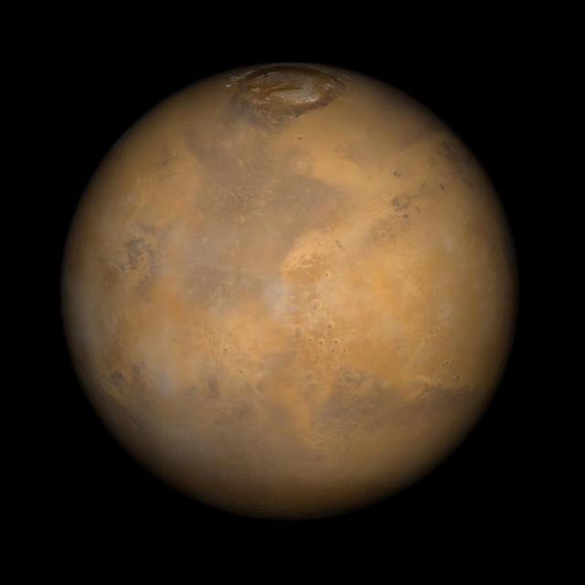
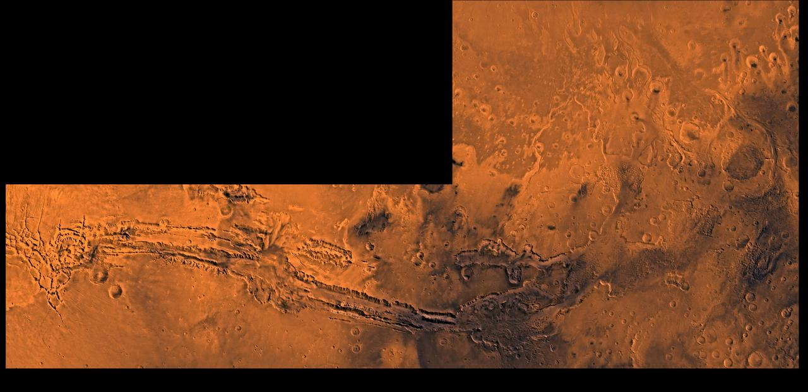

# Mars Pathfinder lander

*The lander that bounced onto Mars inside giant airbags.*

| | |
|---|---|
| Mission | Mars Pathfinder |
| Agency | NASA |
| Where | Mars: Ares Vallis (lat 19.13, lon -33.22) |
| Hardware type | lander |
| Status | **Lost contact**: Last heard from on 27 September 1997, after working three times longer than planned. |
| Launched | 1996-12-04 |
| Arrived | 1997-07-04 |
| Mission ended | 1997-09-27 |

## The story

On 4 July 1997, Mars Pathfinder did something nobody had tried before: it landed on Mars wrapped in giant airbags, bouncing across the ground like a beach ball before rolling to a stop.
Then its petals opened like a flower and a tiny rover named Sojourner drove down a ramp. The lander became the rover's base station, sending its messages to Earth.
Pathfinder photographed its landing site, which showed signs that a huge flood once rushed through the area long ago.

## What it was sent to do

- Test a new low-cost way of landing on Mars using airbags
- Deliver and support the Sojourner rover
- Study Mars's rocks, soil and weather

## Instruments

- **Imager for Mars Pathfinder**: A stereo camera on a mast that photographed the landing site in 3D.
- **Atmospheric and weather package**: Measured temperature, pressure and wind.

## What we learned

- Proved the airbag landing system, later used by the Spirit and Opportunity rovers.
- Rounded pebbles and the shapes of the land suggested that water once flowed there in a giant flood.

## Timeline

- 1996-12-04: Mars Pathfinder launches
- 1997-07-04: Bounces to a landing in Ares Vallis
- 1997-07-06: Sojourner rolls onto the Martian surface
- 1997-09-27: Last contact with Earth

## Fun fact

After landing, the lander was renamed the Carl Sagan Memorial Station after the famous astronomer.

## Sources

- [NASA NSSDCA: Mars Pathfinder](https://nssdc.gsfc.nasa.gov/nmc/spacecraft/display.action?id=1996-068A)

## Image credits

- `image-1.jpg`: **Acidalia and Chryse Plains, Mars**. NASA ID `PIA02000`, JPL, 2000-06-14. <https://images.nasa.gov/details/PIA02000>
- `image-2.jpg`: **Valles Marineris and Chryse Outflow Channels**. NASA ID `PIA00426`, JPL, 1998-06-08. <https://images.nasa.gov/details/PIA00426>

Images from the NASA Image and Video Library. NASA material is generally not copyrighted, but check each image's page for any third-party rights before publishing.
