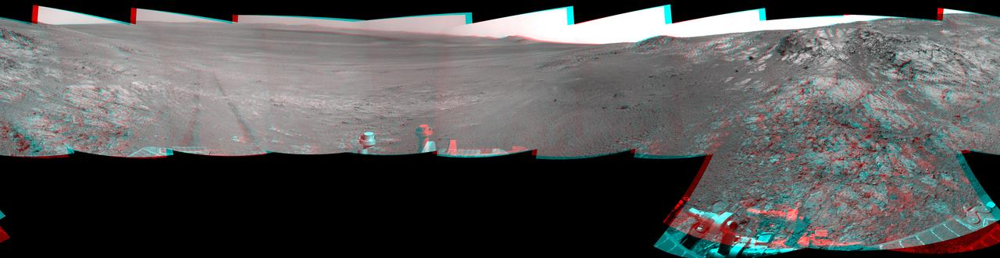
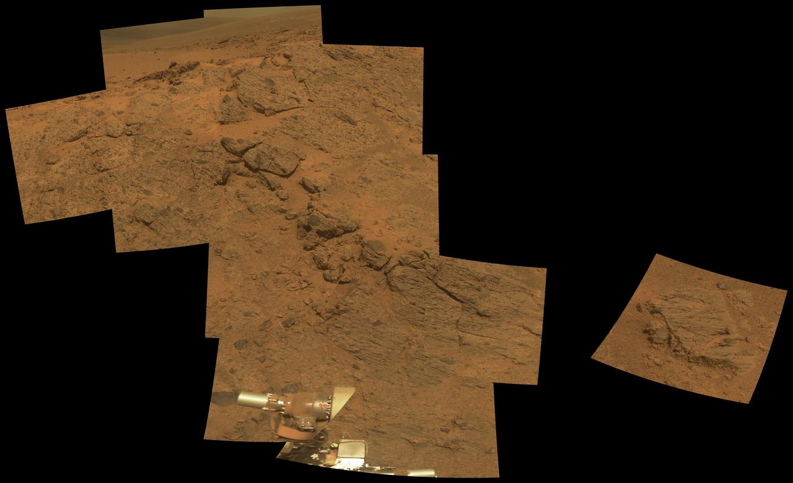

# Opportunity rover

*Built to last 90 Martian days, it kept exploring for more than 14 years.*

| | |
|---|---|
| Mission | Mars Exploration Rover B |
| Agency | NASA |
| Where | Mars: Landed in Eagle crater, Meridiani Planum. Final resting place: Perseverance Valley on the rim of Endeavour crater. (lat -1.95, lon -5.53) |
| Hardware type | rover |
| Status | **Lost contact**: A planet-wide dust storm blocked sunlight from its solar panels. Its last contact was on 10 June 2018, and NASA ended the mission in February 2019. |
| Launched | 2003-07-07 |
| Arrived | 2004-01-25 |
| Mission ended | 2018-06-10 |

## The story

Opportunity was the twin of Spirit. It landed on the other side of Mars and rolled into a small crater, right next to a layer of bedrock. Scientists called it a 'hole in one'!
Close up, the rocks were full of tiny grey balls nicknamed 'blueberries'. They are made of a mineral called hematite, which usually forms in water.
Opportunity kept driving for more than 14 years and covered over 45 km. In 2018, a huge dust storm darkened the sky, and its solar-powered batteries could not recharge.

## What it was sent to do

- Search for evidence that water once existed on Mars
- Study rocks and soil in Meridiani Planum
- Explore as long and as far as possible

## Instruments

- **Panoramic camera (Pancam)**: Took colour panoramas of the landscape.
- **Rock Abrasion Tool**: Ground away the outside of rocks to see the fresh rock inside.
- **Alpha Particle X-ray Spectrometer**: Measured the chemical elements in rocks.
- **Mössbauer spectrometer**: Identified iron minerals, including hematite.
- **Microscopic Imager**: Took close-up pictures of rock grains.

## What we learned

- Hematite 'blueberries' and layered rocks showed that liquid water once soaked the ground.
- Found veins of gypsum, a mineral left behind by water flowing through cracks.
- Drove about 45 km, farther than any rover before it.

## Timeline

- 2003-07-07: Opportunity launches
- 2004-01-25: Lands in Eagle crater, Meridiani Planum
- 2004-03-02: NASA announces evidence that water once soaked the rocks
- 2011-08: Reaches the rim of the giant Endeavour crater
- 2018-06-10: Last contact during a planet-wide dust storm
- 2019-02-13: NASA ends the mission

## Fun fact

Opportunity's mission was planned for 90 Martian days. It worked for more than 5,000.

## Sources

- [NASA NSSDCA: Mars Exploration Rover B (Opportunity)](https://nssdc.gsfc.nasa.gov/nmc/spacecraft/display.action?id=2003-032A)

## Image credits

- `image-1.jpg`: **Opportunity's Surroundings on Sol 3105, Stereo View**. NASA ID `PIA16559`, JPL, 2012-12-19. <https://images.nasa.gov/details/PIA16559>
- `image-2.jpg`: **Outcrop on Murray Ridge Section of Martian Crater Rim**. NASA ID `PIA17752`, JPL, 2014-01-03. <https://images.nasa.gov/details/PIA17752>

Images from the NASA Image and Video Library. NASA material is generally not copyrighted, but check each image's page for any third-party rights before publishing.
