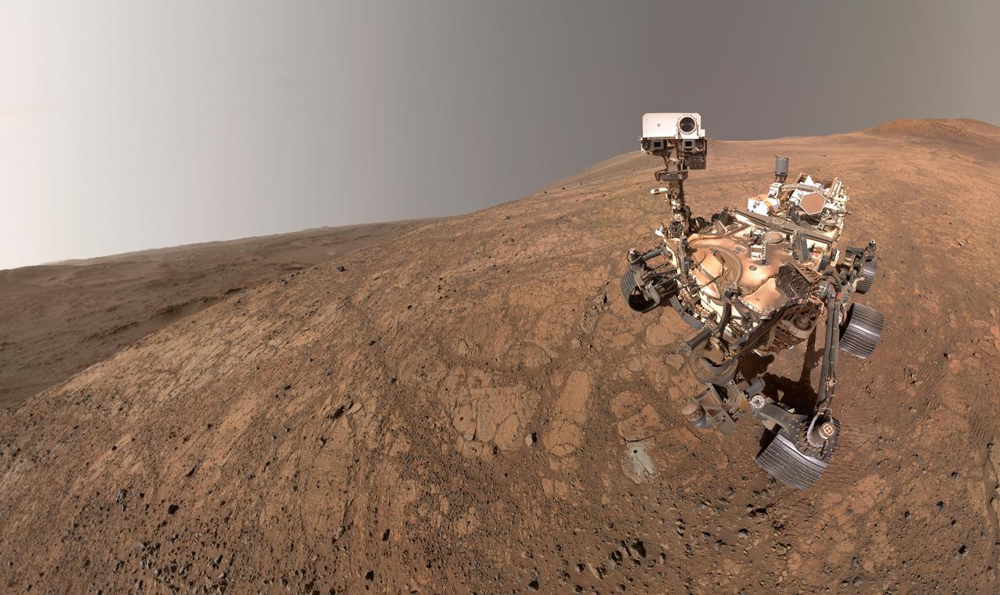
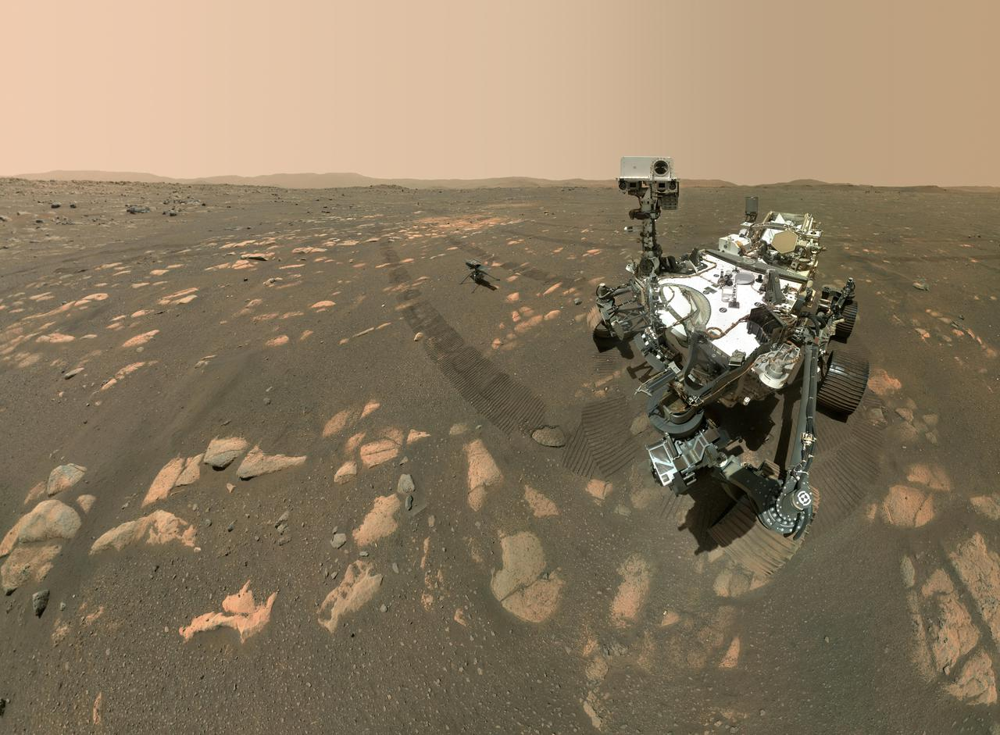

# Perseverance rover

*A rover hunting for signs of ancient life, and saving rock samples for Earth.*

| | |
|---|---|
| Mission | Mars 2020 |
| Agency | NASA |
| Where | Mars: Landed in Jezero crater, the site of an ancient lake and river delta (lat 18.44, lon 77.45) |
| Hardware type | rover |
| Status | **Still working**: Still driving. On 11 October 2026 it passed Opportunity's record to become the farthest-driving vehicle on another world. |
| Launched | 2020-07-30 |
| Arrived | 2021-02-18 |
| Mission ended | still going |

## The story

Perseverance landed in Jezero crater on 18 February 2021. Billions of years ago this crater held a lake, fed by a river that dropped mud and sand into a delta.
Like Curiosity, it is car-sized and nuclear-powered, but its main job is different: to look for signs that tiny life once lived on Mars.
It drills out finger-sized rock cores and seals them in tubes, so that one day a future mission could carry them back to Earth for study.
It also brought a passenger: Ingenuity, a small helicopter that made the first powered, controlled flight on another planet.

## What it was sent to do

- Search for signs of ancient microbial life
- Collect and seal rock and soil samples for possible return to Earth
- Test technology for future human explorers, like making oxygen from Mars's air

## Instruments

- **Mastcam-Z**: A pair of zoomable colour cameras that see in 3D.
- **SuperCam**: A laser, camera and microphone that study rocks from a distance.
- **PIXL and SHERLOC**: Instruments on the arm that map the chemicals and minerals in a rock at tiny scales, looking for clues left by life.
- **RIMFAX**: Ground-penetrating radar that sees layers under the surface.
- **MOXIE**: An experiment that turned carbon dioxide from Mars's air into oxygen.

## What we learned

- A sample called 'Sapphire Canyon', drilled from a rock nicknamed 'Cheyava Falls', contains potential biosignatures. These are possible clues that life may once have been present; scientists say more study is needed before deciding either way.
- Ingenuity proved that a helicopter can fly in Mars's very thin air.
- By October 2026 it had driven 45.22 km (28.10 miles), more than any other vehicle on another world.

## Timeline

- 2020-07-30: Launches from Cape Canaveral
- 2021-02-18: Lands in Jezero crater
- 2021-04-19: Ingenuity makes the first powered flight on another planet
- 2026-10-11: Passes Opportunity's 45.16 km off-world driving record

## Fun fact

Opportunity took almost 15 years to drive its record distance. Perseverance beat it in about 5½ years.

## Sources

- [NASA Science: Mars 2020 Perseverance](https://science.nasa.gov/mission/mars-2020-perseverance/)
- [NASA Science: Ingenuity Mars Helicopter](https://science.nasa.gov/mission/mars-2020-perseverance/ingenuity-mars-helicopter/)

## Image credits

- `image-1.jpg`: **Dust Devil Photobombs Perseverance's Selfie**. NASA ID `PIA26574`, JPL, 2025-05-21. <https://images.nasa.gov/details/PIA26574>
- `image-2.jpg`: **Perseverance's Selfie with Ingenuity**. NASA ID `PIA24542`, JPL, 2021-04-07. <https://images.nasa.gov/details/PIA24542>

Images from the NASA Image and Video Library. NASA material is generally not copyrighted, but check each image's page for any third-party rights before publishing.
