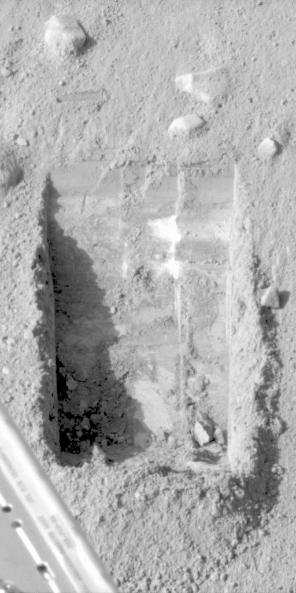
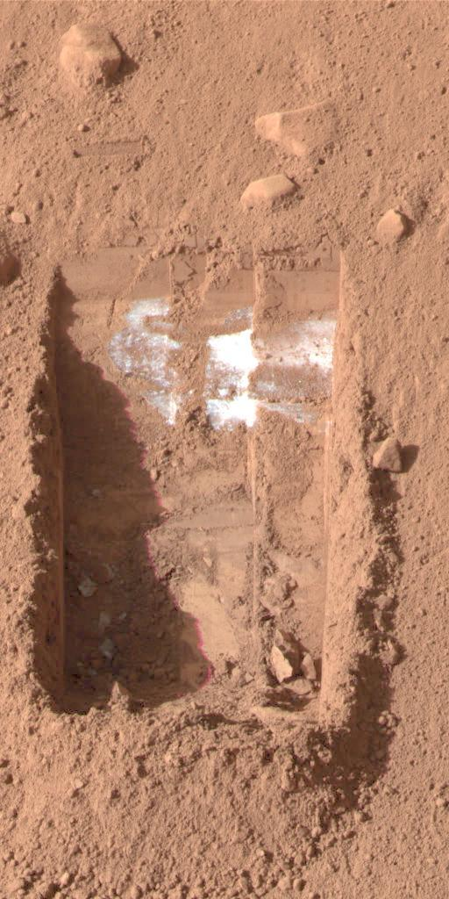

# Phoenix lander

*The lander that touched ice on Mars.*

| | |
|---|---|
| Mission | Phoenix Mars Mission |
| Agency | NASA |
| Where | Mars: Vastitas Borealis, Mars's northern arctic plains (lat 68.22, lon -125.75) |
| Hardware type | lander |
| Status | **Lost contact**: Stopped talking to Earth in November 2008 as the arctic winter set in. Later pictures showed ice had damaged its solar panels. |
| Launched | 2007-08-04 |
| Arrived | 2008-05-25 |
| Mission ended | 2008-11-02 |

## The story

Phoenix landed farther north than any Mars spacecraft before, in a flat arctic plain covered with polygon-shaped cracks.
With its robotic arm, Phoenix dug into the ground and uncovered bright white patches. Days later some of the patches had disappeared. They were water ice, turning straight into vapour in the sunlight!
Phoenix also watched snow falling from Martian clouds. As winter came, the Sun stopped rising, and Phoenix went quiet.

## What it was sent to do

- Dig up and study ice under the surface
- Find out whether the soil could ever have supported tiny life
- Study the weather in Mars's arctic

## Instruments

- **Robotic arm**: Dug trenches and delivered samples to the instruments on deck.
- **Thermal and Evolved Gas Analyzer (TEGA)**: Baked soil samples in tiny ovens to see what gases came out.
- **Wet chemistry lab (MECA)**: Mixed soil with water to measure its chemistry.
- **Weather station with lidar**: Used a laser to study clouds and dust in the sky.

## What we learned

- Confirmed water ice just below the surface of Mars's arctic.
- Found perchlorate, a salt that affects how scientists search for life.
- Saw snow falling from clouds, although it vanished before reaching the ground.

## Timeline

- 2007-08-04: Phoenix launches
- 2008-05-25: Lands using rocket engines in the northern plains
- 2008-06-20: Ice seen vanishing from a trench confirms water ice
- 2008-11-02: Last signal as winter begins
- 2010-05-24: NASA ends the mission after failed attempts to make contact

## Fun fact

Phoenix carried a mini DVD with stories and messages about Mars, as a gift for future explorers.

## Sources

- [NASA NSSDCA: Phoenix](https://nssdc.gsfc.nasa.gov/nmc/spacecraft/display.action?id=2007-034A)

## Image credits

- `image-1.jpg`: **Disappearing Ice**. NASA ID `PIA10906`, JPL, 2008-06-20. <https://images.nasa.gov/details/PIA10906>
- `image-2.jpg`: **Ice on Mars - Now You See It**. NASA ID `PIA10910`, JPL, 2008-06-23. <https://images.nasa.gov/details/PIA10910>

Images from the NASA Image and Video Library. NASA material is generally not copyrighted, but check each image's page for any third-party rights before publishing.
