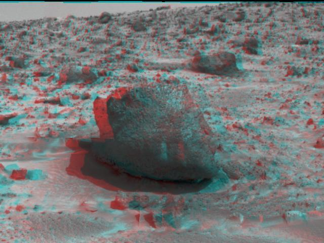
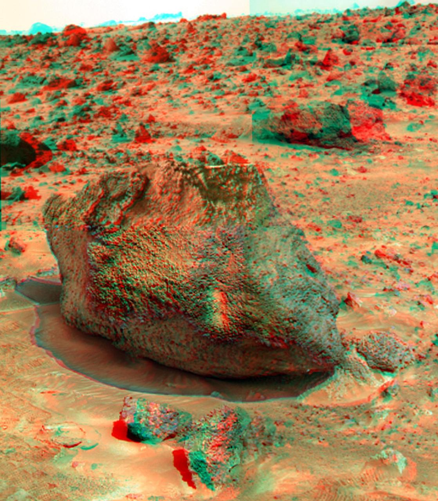

# Sojourner rover

*The first rover on Mars, about the size of a microwave oven.*

| | |
|---|---|
| Mission | Mars Pathfinder |
| Agency | NASA |
| Where | Mars: Near the Pathfinder lander in Ares Vallis (lat 19.13, lon -33.22) |
| Hardware type | rover |
| Status | **Lost contact**: Sojourner talked to Earth through the Pathfinder lander. When the lander went silent in 1997, contact with Sojourner was lost too. |
| Launched | 1996-12-04 |
| Arrived | 1997-07-04 |
| Mission ended | 1997-09-27 |

## The story

Meet Sojourner, one of humanity's first robotic explorers on Mars. It was small, light, and had six wheels.
NASA sent Sojourner to prove that a rover could drive on Mars and study rocks up close. Drivers on Earth chose where it should go, and Sojourner used its own sensors to avoid bumping into rocks on the way.
Sojourner pressed its science instrument against rocks the team nicknamed 'Barnacle Bill' and 'Yogi' to find out what they were made of. Every rover on Mars since has followed in its tracks.

## What it was sent to do

- Prove that a small rover could move around and work on Mars
- Measure what Martian rocks and soil are made of
- Test how wheels behave on Martian ground

## Instruments

- **Alpha Proton X-ray Spectrometer (APXS)**: Measured the chemical elements in rocks and soil.
- **Cameras**: Helped with driving and photographed rocks up close.

## What we learned

- Became the first wheeled vehicle to explore another planet.
- Found that some rocks were richer in silica than scientists expected, hinting that Mars's history was more complicated than thought.
- Showed that a rover could partly drive itself, which helped every later Mars rover.

## Timeline

- 1996-12-04: Launches aboard Mars Pathfinder
- 1997-07-04: Arrives on Mars, folded up on the lander
- 1997-07-06: Drives down the ramp onto Mars
- 1997-07: Studies the rocks 'Barnacle Bill' and 'Yogi'
- 1997-09-27: Contact lost when the lander goes silent

## Fun fact

Sojourner was named after Sojourner Truth, an American who fought for freedom and equal rights.

## Sources

- [NASA NSSDCA: Mars Pathfinder](https://nssdc.gsfc.nasa.gov/nmc/spacecraft/display.action?id=1996-068A)

## Image credits

- `image-1.jpg`: **Yogi the Rock - 3-D**. NASA ID `PIA00688`, JPL, 1997-07-13. <https://images.nasa.gov/details/PIA00688>
- `image-2.jpg`: **Yogi in Super Resolution from Super Panorama**. NASA ID `PIA01430`, JPL, 1998-07-03. <https://images.nasa.gov/details/PIA01430>

Images from the NASA Image and Video Library. NASA material is generally not copyrighted, but check each image's page for any third-party rights before publishing.
