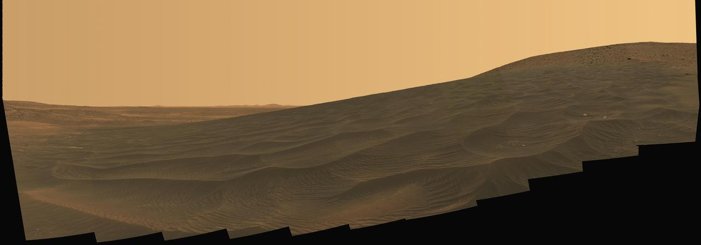
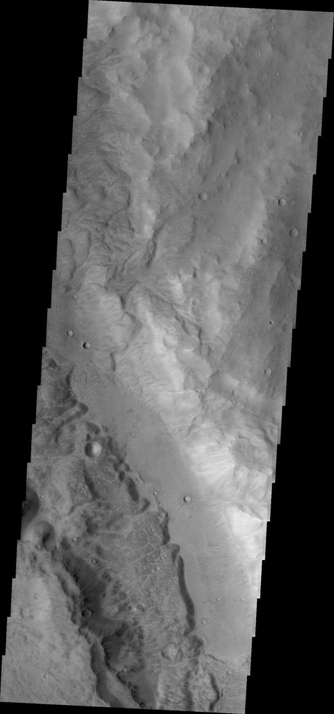

# Spirit rover

*The rover that dug up clues of ancient hot springs.*

| | |
|---|---|
| Mission | Mars Exploration Rover A |
| Agency | NASA |
| Where | Mars: Landed in Gusev crater. Final resting place: a site called Troy, near the Columbia Hills. (lat -14.57, lon 175.47) |
| Hardware type | rover |
| Status | **Lost contact**: Got stuck in soft sand in 2009 and last contacted Earth on 22 March 2010. NASA ended the mission in May 2011. |
| Launched | 2003-06-10 |
| Arrived | 2004-01-04 |
| Mission ended | 2010-03-22 |

## The story

Spirit was planned to work for just 90 Martian days. It kept going for more than six years!
Spirit explored a giant crater called Gusev. When one of its six wheels stopped turning, the team drove it backwards, dragging the broken wheel.
That dragging wheel scraped up bright white soil that turned out to be almost pure silica. On Earth, that kind of soil forms near hot springs or steam vents, places where tiny life can thrive.

## What it was sent to do

- Search rocks and soil for evidence of past water
- Explore Gusev crater and the Columbia Hills
- Test how long a solar-powered rover could survive on Mars

## Instruments

- **Panoramic camera (Pancam)**: Took colour panoramas of the landscape.
- **Rock Abrasion Tool**: Ground away the dusty outside of rocks to see the fresh rock inside.
- **Alpha Particle X-ray Spectrometer**: Measured the chemical elements in rocks and soil.
- **Mössbauer spectrometer**: Identified iron-bearing minerals.
- **Microscopic Imager**: Took close-up pictures of rock grains, like a geologist's hand lens.

## What we learned

- Found nearly pure silica deposits, a sign of ancient hot springs or steam vents.
- Found rocks changed by water in the Columbia Hills.
- Drove about 7.7 km in total.

## Timeline

- 2003-06-10: Spirit launches
- 2004-01-04: Bounces to a landing in Gusev crater
- 2006-03: A front wheel stops working; Spirit starts driving backwards
- 2007-05: Broken wheel uncovers nearly pure silica soil
- 2009-05: Gets stuck in soft sand at Troy
- 2010-03-22: Last contact with Earth
- 2011-05-25: NASA ends the mission

## Fun fact

Gusts of Martian wind sometimes blew dust off Spirit's solar panels, giving it a surprise power boost.

## Sources

- [NASA NSSDCA: Mars Exploration Rover A (Spirit)](https://nssdc.gsfc.nasa.gov/nmc/spacecraft/display.action?id=2003-027A)

## Image credits

- `image-1.jpg`: **Intricately Rippled Sand Deposits**. NASA ID `PIA03274`, JPL, 2006-01-04. <https://images.nasa.gov/details/PIA03274>
- `image-2.jpg`: **Maadim Vallis**. NASA ID `PIA14371`, JPL, 2011-07-05. <https://images.nasa.gov/details/PIA14371>

Images from the NASA Image and Video Library. NASA material is generally not copyrighted, but check each image's page for any third-party rights before publishing.
