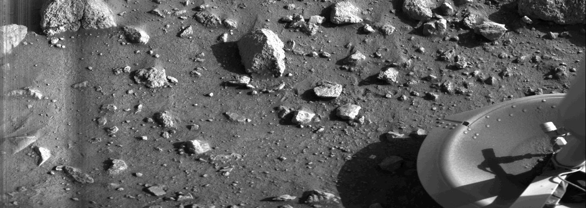
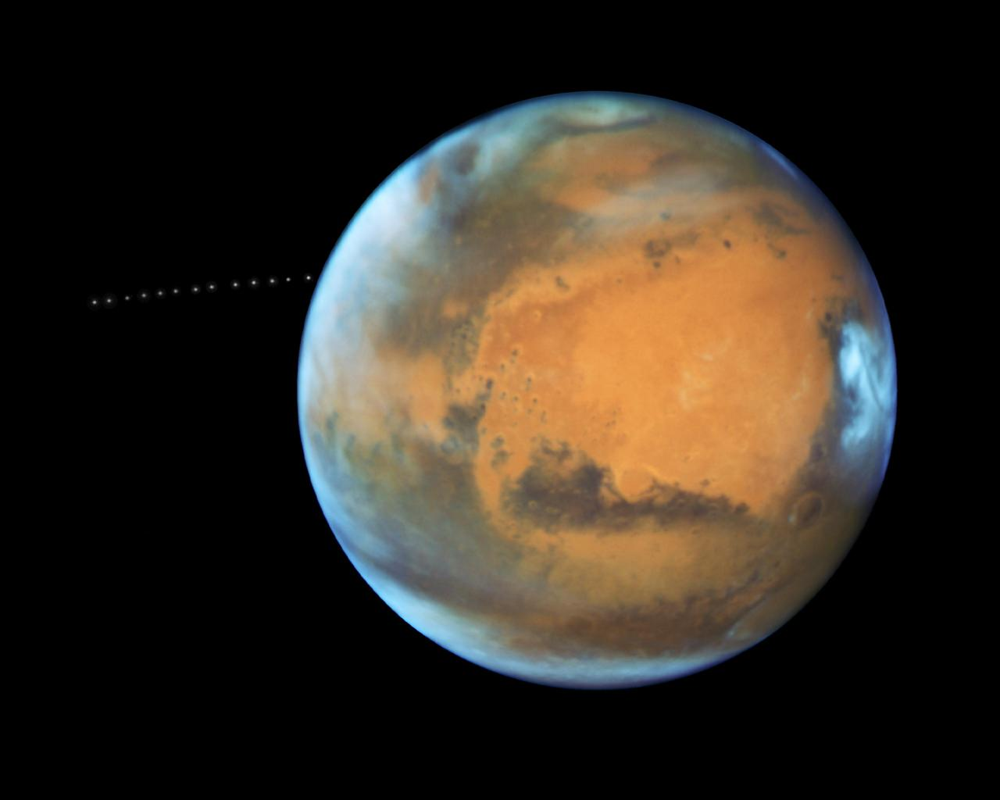

# Viking 1 lander

*The first U.S. spacecraft to land safely on Mars.*

| | |
|---|---|
| Mission | Viking 1 |
| Agency | NASA |
| Where | Mars: Chryse Planitia (Plains of Gold) (lat 22.27, lon -47.95) |
| Hardware type | lander |
| Status | **Lost contact**: Contact was lost in November 1982 after a faulty command was sent from Earth. |
| Launched | 1975-08-20 |
| Arrived | 1976-07-20 |
| Mission ended | 1982-11 |

## The story

In 1976, Viking 1 became the first American spacecraft to land safely on Mars. Within minutes it sent home the first picture ever taken from the Martian surface.
Viking 1 had a mini laboratory on board. It scooped up soil and ran experiments to look for signs of tiny living things.
The results were puzzling and did not give clear proof of life. But Viking 1 kept working and reporting Martian weather for more than six years.

## What it was sent to do

- Land safely and photograph the surface of Mars
- Search the soil for signs of life
- Study Martian weather and the ground

## Instruments

- **Cameras**: Took the first pictures from the surface of Mars.
- **Biology experiments**: Mixed soil with nutrients and gases to look for signs of living things.
- **Gas chromatograph–mass spectrometer**: Searched the soil for carbon-based chemicals.
- **Weather station**: Measured temperature, pressure and wind every day.

## What we learned

- Sent the first images from the surface of Mars.
- Its soil tests did not find clear evidence of life, which shaped how later missions searched.
- Recorded years of Martian weather.

## Timeline

- 1975-08-20: Viking 1 launches
- 1976-06-19: Enters orbit around Mars
- 1976-07-20: Lander touches down in Chryse Planitia
- 1976-07-28: Begins soil experiments searching for life
- 1982-11: Contact lost

## Fun fact

The Viking 1 lander was powered by small nuclear generators instead of solar panels.

## Sources

- [NASA NSSDCA: Viking 1 Lander](https://nssdc.gsfc.nasa.gov/nmc/spacecraft/display.action?id=1975-075C)

## Image credits

- `image-1.jpg`: **First Photograph Taken On Mars Surface**. NASA ID `PIA00381`, JPL, 1996-12-12. <https://images.nasa.gov/details/PIA00381>
- `image-2.jpg`: **NASA's Hubble Sees Martian Moon Orbiting the Red Planet**. NASA ID `PIA21837`, JPL, 2017-07-20. <https://images.nasa.gov/details/PIA21837>

Images from the NASA Image and Video Library. NASA material is generally not copyrighted, but check each image's page for any third-party rights before publishing.
