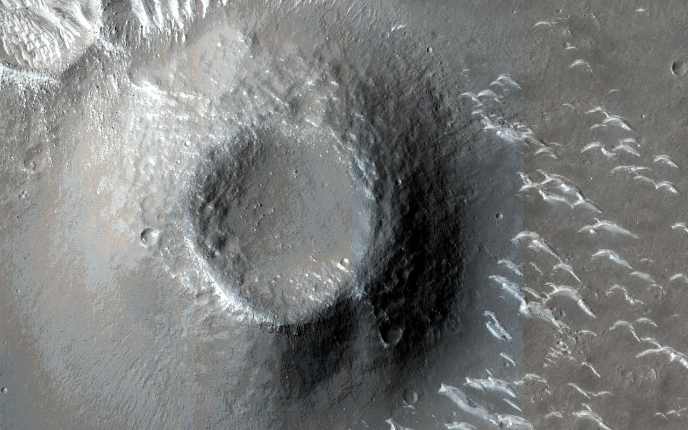

# Zhurong rover

*China's first Mars rover, which used radar to peek under the ground.*

| | |
|---|---|
| Mission | Tianwen-1 |
| Agency | CNSA (China National Space Administration) |
| Where | Mars: Southern Utopia Planitia, a huge plain in Mars's northern hemisphere (lat 25.07, lon 109.93) |
| Hardware type | rover |
| Status | **Inactive**: Went into planned hibernation in May 2022 for the Martian winter and has not woken up; dust on its solar panels is the likely reason. |
| Launched | 2020-07-23 |
| Arrived | 2021-05-14 |
| Mission ended | 2022-05-18 |

## The story

Zhurong is named after a fire god in Chinese mythology. It rode to Mars on the Tianwen-1 spacecraft, which orbited Mars first and then sent the rover down to land.
It is a solar-powered, six-wheeled rover. It drove about 1.9 km (1,921 m) across Utopia Planitia, studying the ground as it went.
In May 2022 it went to sleep to wait out the dusty Martian winter. It has not woken up since.
Zhurong is not NASA hardware, but NASA's Mars Reconnaissance Orbiter photographed it from orbit.

## What it was sent to do

- Study the landforms and rocks of Utopia Planitia
- Use radar to find out what lies beneath the surface
- Measure the weather and magnetic field at the landing site

## Instruments

- **Ground-penetrating radar**: Sent radio waves into the ground and listened for echoes, to map hidden layers.
- **MarSCoDe**: A laser instrument that identifies what rocks are made of.
- **Weather station and magnetometer**: Measured temperature, pressure, wind and the local magnetic field.
- **Navigation and multispectral cameras**: Helped it drive safely and photographed the landscape in different colours of light.

## What we learned

- Its radar revealed layers in the ground beneath Utopia Planitia, a record of the area being built up again and again over a very long time, including possible episodes of flooding.

## Timeline

- 2020-07-23: Tianwen-1 launches from Wenchang, China
- 2021-05-14: Zhurong lands in Utopia Planitia (15 May, China time)
- 2022-05-18: Enters hibernation for the Martian winter

## Fun fact

China became only the second country, after the USA, to drive a rover on Mars.

## Sources

- [Live Science (2023): China finally admits its hibernating Mars rover may never wake up](https://www.livescience.com/space/space-exploration/china-finally-admits-its-hibernating-mars-rover-may-never-wake-up)
- [Nature (2022): Layered subsurface in Utopia Basin of Mars revealed by Zhurong rover radar](https://doi.org/10.1038/s41586-022-05147-5)

## Image credits

- `image-1.jpg`: **The Zhurong Rover Explores Utopia Planitia**. NASA ID `PIA24914`, JPL, 2021-09-29. <https://images.nasa.gov/details/PIA24914>

Images from the NASA Image and Video Library. NASA material is generally not copyrighted, but check each image's page for any third-party rights before publishing.
