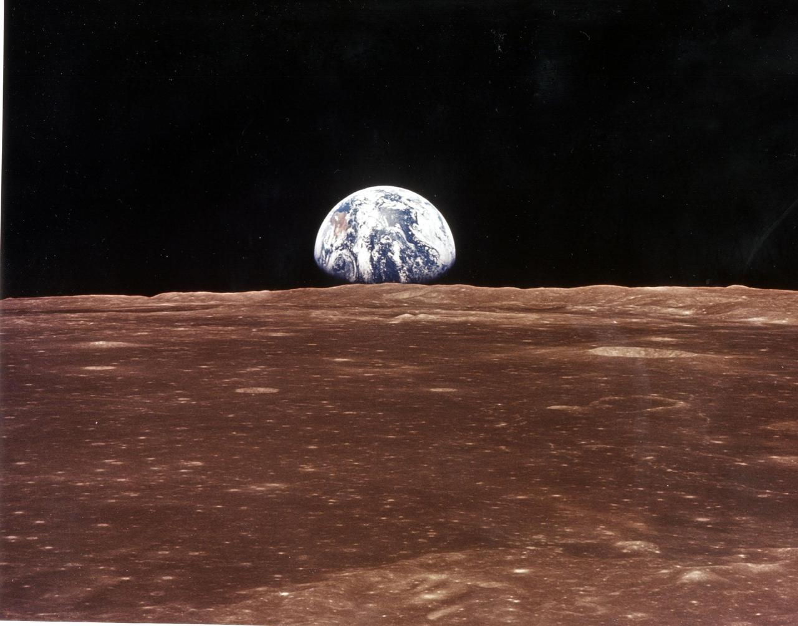
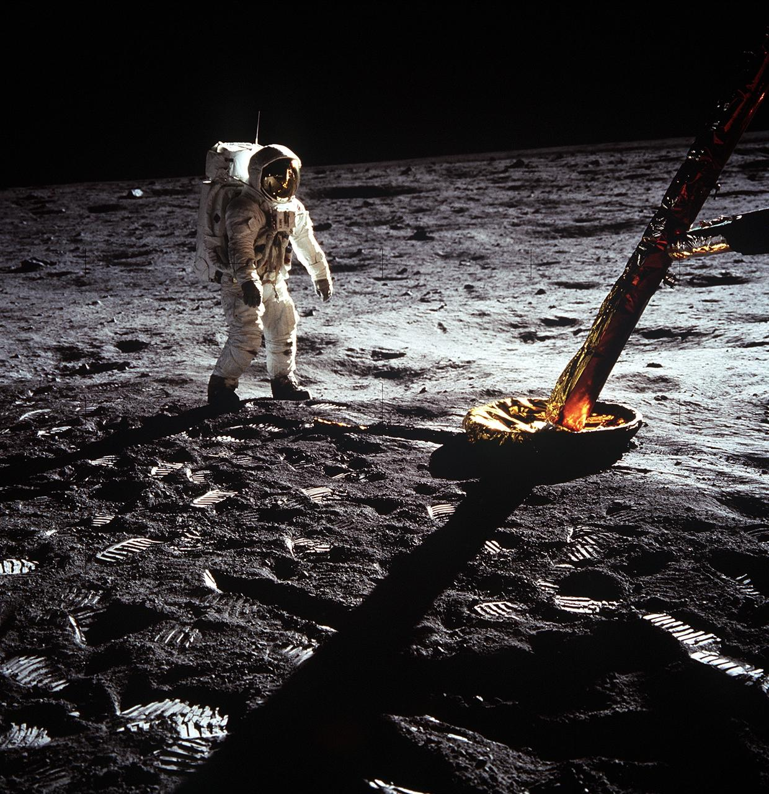

# Eagle Lunar Module descent stage

*The landing legs that carried the first people to walk on the Moon.*

| | |
|---|---|
| Mission | Apollo 11 |
| Agency | NASA |
| Where | The Moon: Tranquility Base, Sea of Tranquility (Mare Tranquillitatis) (lat 0.674, lon 23.473) |
| Hardware type | descent-stage |
| Status | **Inactive**: The descent stage has stood at Tranquility Base since 1969. The laser retroreflector the crew set up nearby is still used by scientists today. |
| Launched | 1969-07-16 |
| Arrived | 1969-07-20 |
| Mission ended | 1969-07-21 |

## The story

Meet Eagle's descent stage: the bottom half of the lunar module that landed Neil Armstrong and Buzz Aldrin on the Moon on 20 July 1969.
The descent stage had a rocket engine that slowed Eagle down as it dropped towards the Moon. Armstrong steered past a field of boulders and touched down with only a little fuel left.
When it was time to go home, the top half (the ascent stage) blasted off and used the descent stage as its launch pad. The descent stage stayed behind, and it is still there today with a plaque on one of its legs.

## What it was sent to do

- Land two astronauts safely on the Moon and return them to Earth
- Collect samples of Moon rock and soil
- Set up the first science experiments on the lunar surface

## Instruments

- **Laser Ranging Retroreflector**: A panel of special mirrors that bounces laser light from Earth straight back, so scientists can measure the distance to the Moon very precisely.
- **Passive Seismic Experiment**: A seismometer that listened for moonquakes and meteorite impacts for a few weeks.
- **Solar Wind Composition experiment**: A sheet of aluminium foil that caught tiny particles streaming from the Sun. The astronauts brought it back to Earth for study.

## What we learned

- Humans walked on another world for the first time.
- The crew brought back about 21.5 kg of Moon rocks and soil, including volcanic rocks formed from ancient lava.
- Laser measurements using the retroreflector show the Moon is slowly moving away from Earth, by about 3.8 cm each year.

## Timeline

- 1969-07-16: Apollo 11 launches on a Saturn V rocket
- 1969-07-19: Spacecraft enters orbit around the Moon
- 1969-07-20: Eagle lands in the Sea of Tranquility
- 1969-07-21: Armstrong and Aldrin explore the surface and set up experiments
- 1969-07-21: Ascent stage lifts off; the descent stage stays behind
- 1969-07-24: The crew splashes down safely on Earth

## Fun fact

A plaque on Eagle's leg says the astronauts 'came in peace for all mankind'.

## Sources

- [NASA NSSDCA: Apollo 11 Lunar Module / EASEP](https://nssdc.gsfc.nasa.gov/nmc/spacecraft/display.action?id=1969-059C)
- [NASA History: Apollo 11 mission summary (SP-4029)](https://www.nasa.gov/wp-content/uploads/static/history/SP-4029/Apollo_11a_Summary.htm)

## Image credits

- `image-1.jpg`: **KSC-as11-44-6549**. NASA ID `KSC-as11-44-6549`, KSC, 1969-07-19. <https://images.nasa.gov/details/KSC-as11-44-6549>
- `image-2.jpg`: **Astronaut Edwin Aldrin walks on lunar surface near leg of Lunar Module**. NASA ID `as11-40-5902`, JSC, 1969-07-20. <https://images.nasa.gov/details/as11-40-5902>

Images from the NASA Image and Video Library. NASA material is generally not copyrighted, but check each image's page for any third-party rights before publishing.
