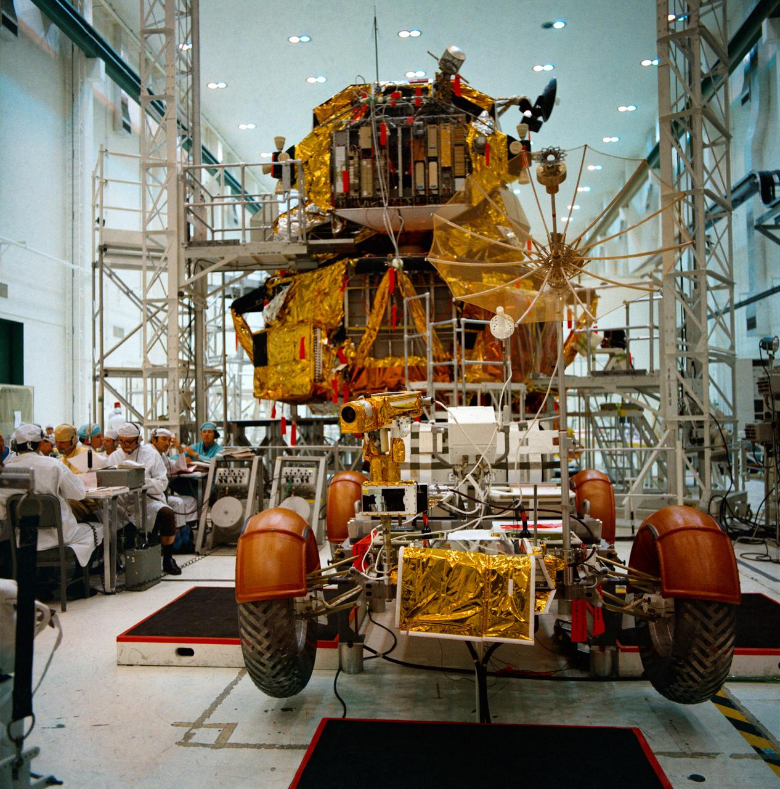
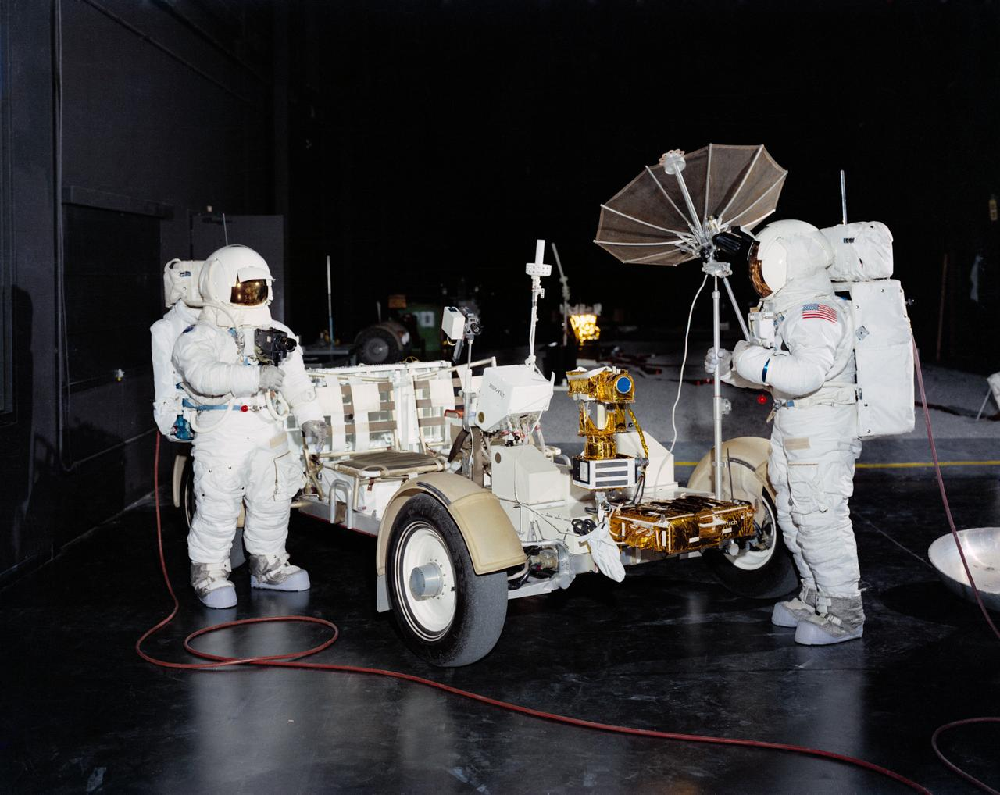

# Lunar Roving Vehicle 1

*The first car ever driven on the Moon.*

| | |
|---|---|
| Mission | Apollo 15 |
| Agency | NASA |
| Where | The Moon: Hadley–Apennine region, near Hadley Rille (lat 26.132, lon 3.634) |
| Hardware type | rover |
| Status | **Inactive**: Parked near the lunar module's landing site since 1971. It no longer works, but it is still there. |
| Launched | 1971-07-26 |
| Arrived | 1971-07-30 |
| Mission ended | 1971-08-02 |

## The story

Meet the first Moon buggy! Apollo 15 brought a folded-up, battery-powered car to the Moon. Astronauts David Scott and James Irwin unfolded it and drove off to explore.
With the rover, the astronauts could travel much farther than on foot. They drove to the edge of a giant valley called Hadley Rille and up the slopes of the Apennine Mountains.
At the end, they parked the rover where its TV camera could film their lift-off. Then it stayed behind for good.

## What it was sent to do

- Carry astronauts and tools much farther across the Moon than they could walk
- Explore Hadley Rille and the Apennine Mountains
- Collect rocks from many different places

## Instruments

- **Colour TV camera**: Controlled from Earth, it sent live pictures of the astronauts at work and filmed the lift-off.
- **Navigation system**: Tracked direction and distance so the astronauts could always find their way back to the lunar module.

## What we learned

- The astronauts drove about 28 km across the Moon over three trips.
- They found the 'Genesis Rock', a piece of the Moon's very ancient crust.
- The mission showed that a rover could greatly expand how much of the Moon astronauts could explore.

## Timeline

- 1971-07-26: Apollo 15 launches
- 1971-07-30: Lunar module Falcon lands at Hadley–Apennine
- 1971-07-31: First drive of a car on the Moon
- 1971-08-01: Genesis Rock collected during the second drive
- 1971-08-02: Rover's camera films the lift-off; the rover stays behind

## Fun fact

The rover folded up like a deck chair so it could fit in a compartment on the side of the lunar module.

## Sources

- [NASA NSSDCA: Apollo 15 Lunar Module / ALSEP](https://nssdc.gsfc.nasa.gov/nmc/spacecraft/display.action?id=1971-063C)

## Image credits

- `image-1.jpg`: **View of Apollo 15 Lunar Roving Vehicle and Lunar Module during simulations**. NASA ID `S71-30542`, JSC, 1971-04-21. <https://images.nasa.gov/details/S71-30542>
- `image-2.jpg`: **Members of Apollo 15 crew shown with Lunar Roving Vehicle One-G trainer**. NASA ID `S71-16722`, JSC, 1971-01-29. <https://images.nasa.gov/details/S71-16722>

Images from the NASA Image and Video Library. NASA material is generally not copyrighted, but check each image's page for any third-party rights before publishing.
