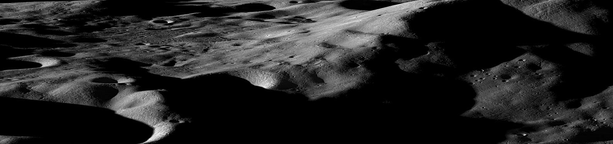

# LCROSS

*The spacecraft that crashed on purpose to find water.*

| | |
|---|---|
| Mission | Lunar Crater Observation and Sensing Satellite |
| Agency | NASA |
| Where | The Moon: Cabeus crater, near the Moon's south pole (lat -84.68, lon -48.7) |
| Hardware type | impactor |
| Status | **Decommissioned**: Crashed into the Moon on purpose in 2009, as planned, after studying the cloud made by its rocket stage. |
| Launched | 2009-06-18 |
| Arrived | 2009-10-09 |
| Mission ended | 2009-10-09 |

## The story

Some craters near the Moon's poles are so deep that sunlight never reaches their floors. Scientists wondered: could ice be hiding there?
LCROSS had a clever plan. First, its empty rocket stage smashed into Cabeus crater, throwing up a giant cloud. Then LCROSS flew straight through the cloud, measuring what was inside, before crashing in too.
Its instruments found water in that cloud. Water on the Moon could one day help astronauts make drinking water, air and even rocket fuel.

## What it was sent to do

- Find out if water ice is hidden in permanently shadowed craters
- Study the cloud thrown up by a deliberate impact

## Instruments

- **Cameras (visible and infrared)**: Watched the impact and the cloud of material it threw up.
- **Spectrometers**: Split light into colours to find out what the cloud was made of, including water.

## What we learned

- Found water in the material thrown up from Cabeus crater.
- Showed that shadowed polar craters can trap water and other substances for a very long time.

## Timeline

- 2009-06-18: Launches together with the Lunar Reconnaissance Orbiter
- 2009-10-09: Rocket stage hits Cabeus crater; LCROSS flies through the cloud
- 2009-10-09: LCROSS itself impacts minutes later, as planned

## Fun fact

LCROSS had about four minutes to study the cloud before it crashed into the Moon itself.

## Sources

- [NASA NSSDCA: LCROSS](https://nssdc.gsfc.nasa.gov/nmc/spacecraft/display.action?id=2009-031B)

## Image credits

- `image-1.jpg`: **Ten Cool Things Seen in the First Year of LRO**. NASA ID `GSFC_20171208_Archive_e002006`, GSFC, 2017-12-08. <https://images.nasa.gov/details/GSFC_20171208_Archive_e002006>

Images from the NASA Image and Video Library. NASA material is generally not copyrighted, but check each image's page for any third-party rights before publishing.
