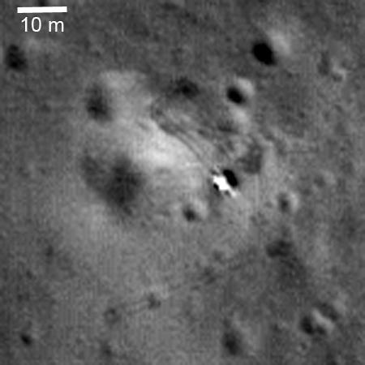
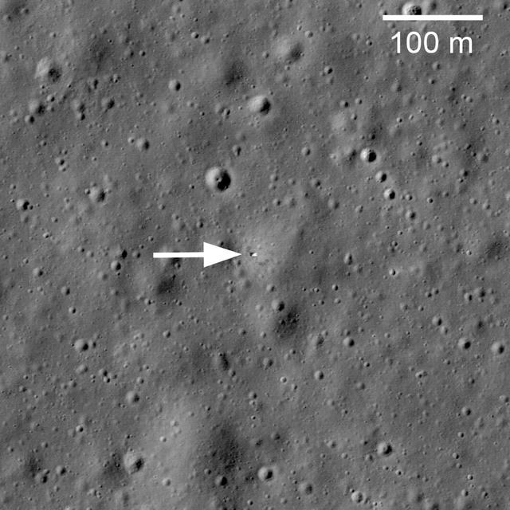

# Lunokhod 1

*The first robot rover to drive on another world.*

| | |
|---|---|
| Mission | Luna 17 |
| Agency | Soviet Union (not NASA) |
| Where | The Moon: Sea of Rains (Mare Imbrium) (lat 38.32, lon -35.0) |
| Hardware type | rover |
| Status | **Inactive**: Stopped working in 1971. Its laser reflector was found again in NASA spacecraft images in 2010 and has been used for laser ranging since. |
| Launched | 1970-11-10 |
| Arrived | 1970-11-17 |
| Mission ended | 1971-09-14 |

## The story

This one is not from NASA, but it is too important to leave out. Lunokhod 1 was built by the Soviet Union, and it was the first remote-controlled robot to drive on another world.
It looked like a bathtub on eight wheels. A team on Earth steered it using pictures from its cameras, even though every picture took time to arrive.
Lunokhod 1 explored for about ten months. Years later, NASA's Lunar Reconnaissance Orbiter photographed it from above, and scientists started bouncing lasers off its mirror again.

## What it was sent to do

- Drive a robot on the Moon, controlled from Earth
- Photograph the surface and study the soil
- Carry a laser reflector for measuring the Earth–Moon distance

## Instruments

- **TV cameras**: Helped the drivers on Earth see where to steer, and photographed the landscape.
- **X-ray fluorescence spectrometer**: Measured which chemical elements are in the lunar soil.
- **Penetrometer**: Pushed into the ground to test how firm it was.
- **Laser retroreflector**: French-built mirrors for measuring the distance to the Moon.

## What we learned

- Showed that a robot could be driven on another world from Earth.
- Travelled about 10.5 km and studied the soil at many stops.

## Timeline

- 1970-11-10: Luna 17 launches from the Soviet Union
- 1970-11-17: Lands in the Sea of Rains; Lunokhod 1 rolls off
- 1971-09-14: Last contact with Earth
- 2010-03: Located in images from NASA's Lunar Reconnaissance Orbiter

## Fun fact

Lunokhod 1 had a lid covered in solar cells that opened during the lunar day and closed at night to keep it warm.

## Sources

- [NASA NSSDCA: Luna 17 / Lunokhod 1](https://nssdc.gsfc.nasa.gov/nmc/spacecraft/display.action?id=1970-095A)

## Image credits

- `image-1.jpg`: **Luna 21 Lander**. NASA ID `PIA12976`, JPL, 2010-03-19. <https://images.nasa.gov/details/PIA12976>
- `image-2.jpg`: **Soviet Union Lunar Rovers**. NASA ID `PIA12967`, JPL, 2010-03-17. <https://images.nasa.gov/details/PIA12967>

Images from the NASA Image and Video Library. NASA material is generally not copyrighted, but check each image's page for any third-party rights before publishing.
