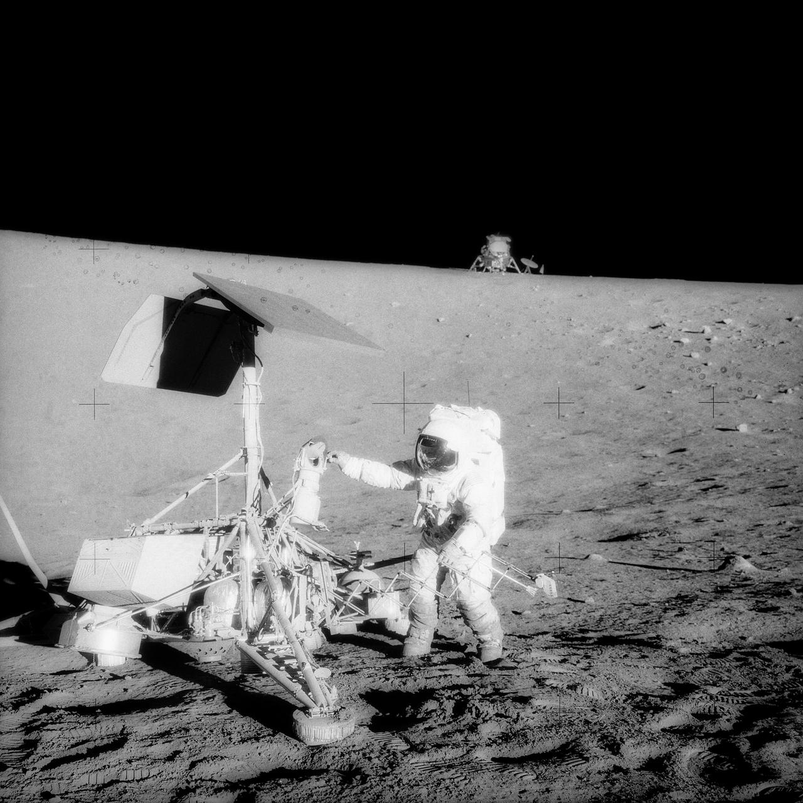
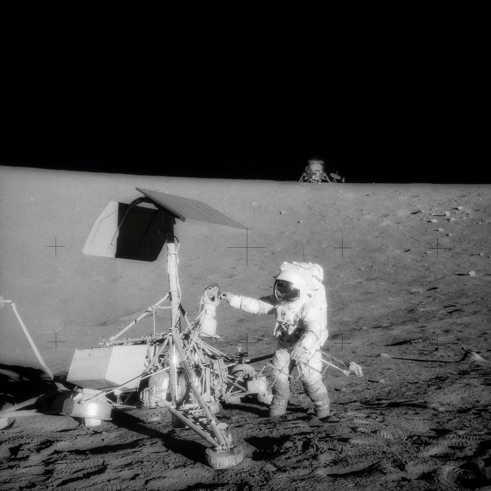

# Surveyor 3

*The robot that got a visit from astronauts.*

| | |
|---|---|
| Mission | Surveyor 3 |
| Agency | NASA |
| Where | The Moon: Ocean of Storms (Oceanus Procellarum) (lat -3.015, lon -23.418) |
| Hardware type | lander |
| Status | **Inactive**: Silent since May 1967. Astronauts visited it in 1969 and brought some of its parts back to Earth. |
| Launched | 1967-04-17 |
| Arrived | 1967-04-20 |
| Mission ended | 1967-05-04 |

## The story

Before people could land on the Moon, NASA had to answer a big question: is the ground solid enough to stand on? Surveyor 3 was sent to find out.
It had a little scoop on a mechanical arm. Engineers on Earth used it to dig trenches and poke the soil, and its camera sent back thousands of pictures.
Two and a half years later, Apollo 12 landed close by. Astronauts Pete Conrad and Alan Bean walked over to Surveyor 3 and cut off its camera and other parts to bring home, so scientists could see how materials change on the Moon.

## What it was sent to do

- Prove a spacecraft could land softly on the Moon
- Test whether lunar soil could hold up a crewed spacecraft
- Take pictures of the landing area

## Instruments

- **TV camera**: Took thousands of pictures of the surface around the lander.
- **Surface sampler**: A scoop on an arm that dug trenches to test how firm the soil was.

## What we learned

- The Moon's soil was firm enough to support landing spacecraft and astronauts.
- It was the first spacecraft to dig into the surface of another world.
- Parts returned by Apollo 12 helped scientists study how materials age on the Moon.

## Timeline

- 1967-04-17: Surveyor 3 launches
- 1967-04-20: Lands in the Ocean of Storms, bouncing before it settles
- 1967-04: Digs trenches and takes thousands of pictures
- 1967-05-04: Last contact with Earth
- 1969-11-20: Apollo 12 astronauts visit and remove parts to bring home

## Fun fact

Its engines did not shut off right away when it landed, so Surveyor 3 bounced across the Moon before settling down.

## Sources

- [NASA NSSDCA: Surveyor 3](https://nssdc.gsfc.nasa.gov/nmc/spacecraft/display.action?id=1967-035A)

## Image credits

- `image-1.jpg`: **Apollo 12 Mission image - Astronaut Alan L. Bean,lunar module pilot,and two U.S. spacecraft **. NASA ID `AS12-48-7134`, JSC, 1969-11-20. <https://images.nasa.gov/details/AS12-48-7134>
- `image-2.jpg`: **View of two U.S. spacecraft on the surface of the moon**. NASA ID `AS12-48-7133`, JSC, 1969-11-20. <https://images.nasa.gov/details/AS12-48-7133>

Images from the NASA Image and Video Library. NASA material is generally not copyrighted, but check each image's page for any third-party rights before publishing.
